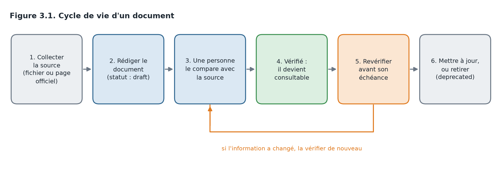
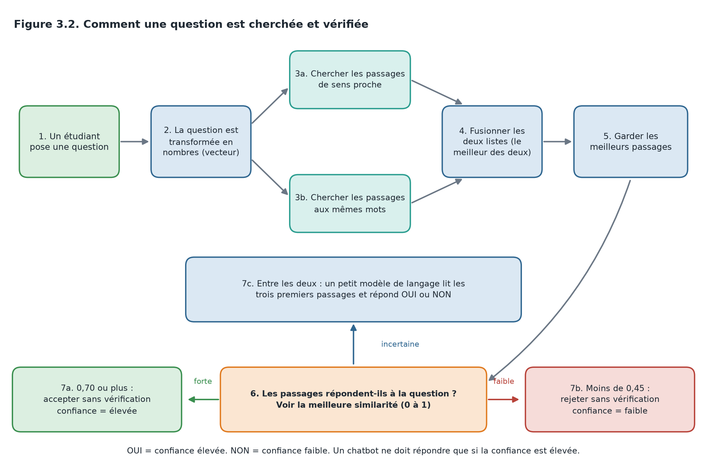
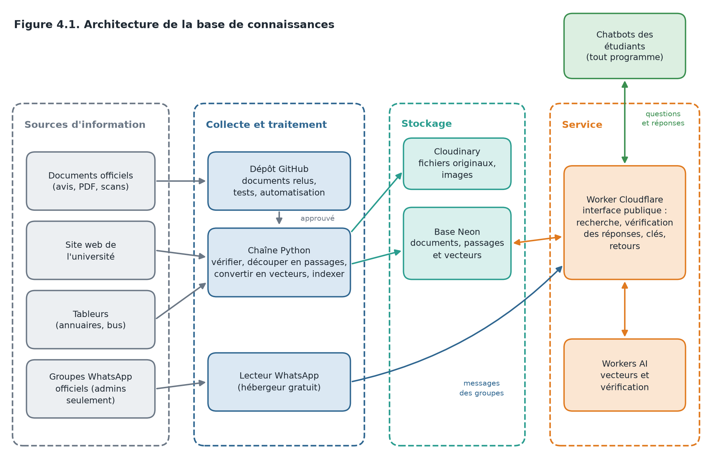

# Conception et réalisation d'une base de connaissances partagée pour les chatbots d'ICT University

Cours : CSC 4121 Intelligence artificielle, automne 2026
Établissement : ICT University, Yaoundé, Cameroun
Type de projet : Projet de groupe, base de connaissances partagée
Auteurs (première version) : EGBE MICHEL TAMBE, ICTU20233746 ; NDONWIE NELLY TANWIE, ICTU20233987 ; AJA CHELLA ASAMBA Jr, ICTU20233787
Liste complète et à jour des contributeurs : CONTRIBUTORS.md dans le dépôt et https://github.com/Egbemichel/ictukb/graphs/contributors
Enseignant : Dr Fotsing Kuetche
Date : 18 novembre 2026
Dépôt : https://github.com/Egbemichel/ictukb

---

## Résumé

Les étudiants et le personnel d'ICT University ont souvent besoin de réponses à des questions de tous les jours : combien payer, quand s'inscrire, comment demander un relevé de notes, où a lieu un cours. Les réponses sont dispersées entre un site web, des avis signés, des documents de politique et un système administratif. Un chatbot peut aider, mais seulement s'il lit des données correctes.

Ce rapport décrit une base de connaissances partagée que de nombreux chatbots d'étudiants peuvent consulter. Le système conserve des documents officiels, des pages du site web et de courtes annonces quotidiennes sous forme de petits morceaux de texte appelés passages. Il les range dans une base de données qui sait chercher par le sens et par les mots-clés. Après une recherche, il vérifie si les passages répondent vraiment à la question. N'importe quel chatbot peut utiliser le système grâce à une interface publique gratuite et à une clé d'accès. Chaque document indique d'où il vient, qui l'a vérifié et à quelle fréquence il doit être revérifié. Lorsque deux sources se contredisent, le document officiel signé le plus récent l'emporte. Les informations privées ne sont jamais stockées.

Au moment de la rédaction, la base contient 80 documents répartis en 679 passages. Nous l'avons testée avec 103 questions. Pour les 98 questions auxquelles les documents de l'université peuvent répondre, 63 (64,3 %) avaient déjà un document correspondant dans la base. Pour ces 63 questions, le bon document figurait parmi les cinq premiers résultats dans 88,9 % des cas, et pour les 19 questions les plus importantes sans exception. Les 5 questions auxquelles le système ne doit pas répondre ont toutes été refusées. Le système fonctionne et ne coûte rien à faire tourner. Il reste surtout à collecter les documents manquants auprès des services de l'université.

Mots-clés : base de connaissances, recherche d'information, recherche vectorielle, recherche hybride, chatbot, information universitaire, qualité des données.

---

## Table des matières

1. Introduction
2. Revue de la littérature
3. Méthodologie
4. Conception du système
5. Réalisation
6. Résultats et discussion
7. Conclusion et recommandations

Références

Annexe A : Métadonnées d'un document
Annexe B : Résumé de l'interface
Annexe C : Format des questions de test
Annexe D : Organisation du dépôt

---

## Chapitre 1. Introduction

### 1.1 Contexte

Une université produit beaucoup d'informations pratiques. Les candidats doivent savoir comment postuler et quelles pièces envoyer. Les étudiants doivent connaître les dates d'inscription, le montant des frais de scolarité et la façon de les payer en plusieurs fois. Ils doivent aussi savoir comment demander un relevé de notes, comment repasser un examen, quand ont lieu leurs cours et où se trouve un bureau. Ces informations sont conservées à de nombreux endroits : pages du site web, avis signés, documents de politique, formulaires, messages dans des groupes WhatsApp officiels et système administratif de l'université (l'ERP). Aucun endroit ne donne à lui seul la réponse complète à une question comme « Jusqu'à quand puis-je m'inscrire aux cours, et que se passe-t-il après cette date ? ». La réponse peut être partagée entre un communiqué et un avis du service financier.

Un chatbot est un moyen naturel de poser ces questions. Mais un chatbot qui répond à partir de ses connaissances générales donnera parfois une réponse fausse sur une université précise, et il aura l'air sûr de lui. Une meilleure méthode comporte deux étapes. D'abord, le chatbot cherche les passages utiles dans une réserve de confiance. Ensuite, il rédige sa réponse à partir de ces passages. Cette méthode s'appelle la génération augmentée par la recherche (Lewis et al., 2020). Elle a une conséquence claire : une réponse ne peut jamais être plus correcte que la réserve dans laquelle elle puise.

Dans le cours CSC 4121 (Intelligence artificielle), chaque étudiant construit son propre chatbot pour l'université. La classe a décidé que tous les chatbots liraient une même base de connaissances partagée. Cela évite que chacun collecte à nouveau les mêmes données. Ce rapport décrit cette base de connaissances.

### 1.2 Problématique

Trois problèmes ont motivé ce projet.

1. **Information dispersée.** L'information officielle se trouve à plusieurs endroits et sous plusieurs formes. Une partie est dans des images numérisées dans lesquelles on ne peut pas chercher.
2. **Information qui change.** Certains faits changent à chaque semestre (frais, dates, emplois du temps). D'autres changent chaque jour (le menu de la cantine, les annonces). Un ensemble fixe de documents devient faux si personne ne le met à jour.
3. **Confiance.** Un étudiant qui reçoit d'un chatbot une mauvaise date limite ou un mauvais montant peut perdre de l'argent. Le système doit donc savoir quels faits sont vérifiés, d'où ils viennent et quel âge ils ont. Il doit aussi savoir quand il n'a pas la réponse.

### 1.3 Objectifs

L'objectif général était de concevoir, construire, déployer et tester une base de connaissances partagée et ouverte sur ICT University. Les chatbots des étudiants peuvent s'en servir pour obtenir des informations correctes, actuelles et accompagnées de leur source.

Les objectifs spécifiques étaient les suivants :

1. décider ce que la base de connaissances doit contenir et le collecter auprès de sources officielles ;
2. concevoir un modèle de données qui note la source, la date, le responsable et l'état de vérification de chaque document ;
3. construire une chaîne de traitement qui transforme des documents, des pages web, des tableurs et des messages en passages consultables ;
4. construire une recherche qui fonctionne en français et en anglais et qui sait détecter qu'elle n'a pas la réponse ;
5. offrir une interface publique avec contrôle d'accès, et l'héberger gratuitement ;
6. garder les données à jour, avec des mises à jour quotidiennes et presque en temps réel ;
7. mesurer la qualité de la recherche avec une liste fixe de questions de test.

### 1.4 Questions de recherche

QR1. Une recherche qui combine le sens et les mots-clés peut-elle placer le bon document officiel parmi les cinq premiers résultats pour la plupart des questions ?

QR2. Le système peut-il faire la différence entre les questions auxquelles les documents répondent et celles auxquelles ils ne répondent pas ?

QR3. Le système peut-il être construit, hébergé et maintenu à jour avec des services entièrement gratuits ?

### 1.5 Portée et limites

La base de connaissances couvre treize catégories : l'université, les admissions, les programmes, les procédures académiques, les finances, l'ERP, le campus, le transport, la cantine, les emplois du temps, les personnes, la vie étudiante et les annonces. Elle contient l'emploi du temps du semestre d'automne 2026 du programme de licence en anglais. Les autres emplois du temps n'y sont pas. Le système ne stocke aucune donnée personnelle. Il ne rédige pas les réponses : c'est le travail de chaque chatbot. Ce rapport ne teste aucun chatbot. Il teste seulement la base de connaissances.

### 1.6 Importance du projet

Le projet donne à la classe une source unique et fiable de faits sur l'université et évite un travail répété. Il montre aussi une méthode complète, de la collecte à l'hébergement, que d'autres départements peuvent réutiliser. Comme chaque fait a une source et une date, les erreurs peuvent être retrouvées et corrigées.

### 1.7 Termes clés

Passage (chunk) : un court morceau d'un document, comme quelques phrases ou une partie d'un tableau. Il est stocké et retrouvé comme une seule unité.

Plongement (embedding, ou vecteur) : une liste de nombres (ici 1 024 nombres) qui représente le sens d'un texte. Deux textes de sens proche ont des vecteurs proches.

Recherche (retrieval) : trouver les passages qui correspondent le mieux à une question.

Niveau de fraîcheur : le temps maximal autorisé entre deux vérifications d'un document.

Document vérifié : un document qu'une personne nommée a comparé avec une source officielle.

### 1.8 Organisation du rapport

Le chapitre 2 passe en revue les travaux existants. Le chapitre 3 explique la méthode. Le chapitre 4 décrit la conception du système et le chapitre 5 sa réalisation. Le chapitre 6 donne et discute les résultats. Le chapitre 7 conclut et formule des recommandations.

---

## Chapitre 2. Revue de la littérature

### 2.1 Répondre à des questions à partir d'un ensemble fixe de documents

Répondre à des questions à partir d'un petit ensemble de documents de confiance est différent de répondre à n'importe quelle question sur n'importe quel sujet. L'ensemble est petit, on sait qui l'a écrit, et une erreur a un coût. Pour cette raison, les assistants universitaires cherchent en général dans les documents de l'université plutôt que de s'appuyer sur des connaissances générales. Trois questions de conception en découlent : comment représenter les documents, comment les chercher et comment les garder corrects dans le temps.

### 2.2 Recherche par mots-clés et recherche par le sens

La recherche classique classe les documents selon les mots qu'ils ont en commun avec la question. Une méthode connue est BM25. Elle donne plus de poids aux mots rares et tient compte de la longueur du document. Elle reste depuis de nombreuses années une base de comparaison solide (Robertson et Zaragoza, 2009 ; Manning, Raghavan et Schütze, 2008). Son point faible est que des mots différents peuvent avoir le même sens. Une question qui dit « payer en plusieurs fois » ne correspondra pas à un passage qui dit « les frais peuvent être réglés par tranches ».

La recherche par le sens (recherche dense) corrige ce défaut. Un modèle entraîné transforme la question et chaque passage en vecteurs, et la recherche classe les passages selon la proximité de leurs vecteurs (Karpukhin et al., 2020 ; Reimers et Gurevych, 2019). Certains modèles gèrent plusieurs langues dans un même espace, de sorte qu'une question en français peut trouver un passage en anglais. C'est utile dans une université bilingue.

La recherche par le sens a aussi un point faible. Elle peut renvoyer un passage sur le bon sujet qui ne contient pas le fait demandé. Elle est aussi moins bonne avec les noms et les codes exacts, comme les codes de cours. Utiliser les deux types de recherche ensemble est une solution courante.

### 2.3 Recherche vectorielle rapide et fusion de deux listes de résultats

Comparer une question avec chaque vecteur stocké est lent quand il y a beaucoup de données. Les bases de données vectorielles utilisent donc des index de plus proches voisins approchés. L'un des meilleurs est le graphe HNSW (Malkov et Yashunin, 2020). Il est disponible dans pgvector, une extension de la base de données PostgreSQL (Kane, 2021). Quand les vecteurs et les autres données sont dans la même base, une seule requête peut chercher et filtrer par catégorie, niveau ou date.

Deux listes classées, l'une issue des mots-clés et l'autre du sens, peuvent être fusionnées par la fusion des rangs réciproques. Chaque passage reçoit un score égal à la somme de 1 divisé par son rang dans chaque liste (Cormack, Clarke et Büttcher, 2009). Cette méthode n'exige aucun réglage des échelles de score, et elle a donné de meilleurs résultats que plusieurs méthodes plus complexes.

### 2.4 Génération augmentée par la recherche et ses échecs

Dans la génération augmentée par la recherche, les passages trouvés sont donnés à un modèle de langage avec la question (Lewis et al., 2020). Deux échecs sont importants ici. Premièrement, si les passages ne contiennent pas la réponse, le modèle peut quand même répondre avec assurance. Deuxièmement, si les passages sont anciens ou se contredisent, la réponse répète l'erreur. Ces deux problèmes viennent de la réserve de données et de la recherche, pas de la rédaction de la réponse. C'est pourquoi le projet concentre son effort sur la vérification des passages et sur l'enregistrement de l'origine des documents.

### 2.5 Découper les documents en passages

Les documents sont découpés en passages avant d'être indexés. Un passage trop long mélange plusieurs idées et son vecteur devient moins précis. Un passage trop court perd son contexte. Il est efficace de découper selon la structure du document (titres, paragraphes, lignes de tableau) et de mettre le titre et l'intertitre au début de chaque passage, pour qu'il se comprenne seul. Les tableaux demandent une attention particulière : on les découpe par lignes et on répète la ligne d'en-tête dans chaque morceau.

### 2.6 Fraîcheur et source

La qualité d'une information dépend de sa date et de son auteur. Les frais et les emplois du temps sont valables un semestre. Une annonce est valable quelques jours. Si chaque document a une durée de vie attendue et une date de dernière vérification, et que les deux sont montrées à l'utilisateur, le système peut avertir qu'une information est peut-être ancienne. Si la source et la personne qui a vérifié sont notées, une erreur peut être retrouvée et corrigée. Une règle claire pour les contradictions rend aussi le résultat prévisible. Ici, la règle est que le document officiel signé le plus récent l'emporte.

### 2.7 Mesurer la qualité d'une recherche

On teste d'habitude une recherche avec une liste fixe de questions dont on connaît les bons documents. La mesure « réussite à k » indique si un bon document figure parmi les k premiers résultats. Le rang réciproque moyen (MRR) est la moyenne de 1 divisé par la position du premier bon résultat (Voorhees, 1999). Un système qui doit aussi savoir refuser certaines questions a besoin d'une mesure de plus : la part des questions sans réponse qu'il a refusées. La liste de questions peut être écrite avant que les documents existent. Pour cette raison, la part des questions qui ont un document dans la base doit être indiquée à part. Sinon, un document manquant ressemble à une erreur de recherche.

### 2.8 La base de connaissances comme partie d'un agent

Dans ce cours, un chatbot est un agent. Il reçoit les messages de l'étudiant et ses actions sont ses réponses. Un agent qui doit donner des réponses correctes a besoin d'un composant de connaissances exact, actuel et facile à interroger (Russell et Norvig, 2021). La base de connaissances de ce rapport est ce composant. Elle est gardée en dehors de l'agent pour pouvoir être partagée et mise à jour séparément.

### 2.9 Ce que ce projet apporte

Les méthodes de recherche existent déjà. Ce projet les assemble pour un établissement précis, avec des contraintes réelles : un ensemble de documents petit, bilingue et en partie numérisé, des faits qui changent à des vitesses différentes, aucun budget, et un résultat qui doit être ouvert à toute une classe. Les chapitres suivants montrent comment ces contraintes ont façonné la méthode.

---

## Chapitre 3. Méthodologie

### 3.1 Démarche de recherche

Nous avons travaillé par cycles répétés. Chaque cycle avait quatre étapes : collecter un lot de sources, les transformer en documents et les indexer, mesurer la qualité de la recherche avec la liste fixe de questions, puis corriger les données ou le système là où les questions échouaient. Nous avons écrit la liste de questions avant que les documents existent. Ainsi, les progrès pouvaient être mesurés de façon équitable. Le chapitre 6 donne les résultats de chaque cycle.

### 3.2 Besoins

Les besoins sont venus du sujet du cours et des questions que posent les étudiants. Les personnes concernées sont les étudiants qui construisent des chatbots, les étudiants et le personnel qui posent des questions, et l'administration.

Besoins fonctionnels. Le système doit :

- stocker les treize catégories d'information, y compris des documents, des images et des tableaux ;
- répondre aux questions en français et en anglais ;
- renvoyer avec chaque résultat la source et la date de dernière vérification ;
- reconnaître les questions auxquelles il ne peut pas répondre ;
- accepter des mises à jour rapides pour les informations qui changent vite ;
- donner accès à chaque chatbot par une interface documentée avec des clés d'accès.

Autres besoins. Le système doit :

- être open source et protégé contre les modifications non autorisées ;
- ne contenir aucune donnée sensible ;
- ne rien coûter à faire fonctionner ;
- rester facile à maintenir par une équipe d'étudiants qui change avec le temps.

### 3.3 Sources et méthode de collecte

Nous avons collecté l'information auprès des sources ci-dessous, de la plus officielle à la moins officielle.

| Source | Contenu | Méthode |
|---|---|---|
| Avis, politiques et lettres signés | Règlement académique, dates d'inscription, contrôle des frais, comptes bancaires | Fichiers fournis par l'équipe ; pages numérisées lues et recopiées |
| Manuel d'utilisation de l'ERP | Procédures, barème de notation, frais, rattrapages, relevés, réclamations | Lu dans le manuel officiel à l'intérieur du système ; aucune donnée personnelle utilisée |
| Site web de l'université | Programmes, conditions d'admission, facultés, calendrier, actualités | Interface publique du site, lue chaque jour |
| Emploi du temps (PDF) | Cours du semestre d'automne 2026 | Extraction des tableaux, puis tableaux par jour et listes par programme |
| Messages de groupes officiels | Menu de la cantine, annonces, nouvelles de la vie étudiante | Messages des administrateurs de quatre groupes officiels, reçus automatiquement |
| Tableurs | Annuaires, cantine, transport | Modèles préparés ; les services doivent les remplir |

Sept règles ont guidé la collecte :

1. chaque élément note sa source, sa date et la personne qui l'a collecté ;
2. les fichiers originaux sont conservés et non retapés ;
3. les fichiers sont nommés par catégorie, sujet et date ;
4. toute information donnée oralement est confirmée par écrit ;
5. si deux sources se contredisent, on utilise le document officiel signé le plus récent, et la contradiction est écrite dans le document ;
6. seuls les contacts officiels sont stockés ;
7. aucun secret ni aucune donnée personnelle n'entre dans le dépôt.

Un rapport non officiel compilé par quelqu'un nous a été remis pendant le projet. Il ne venait pas de l'université, donc nous ne l'avons pas utilisé pour vérifier des faits.

Pour organiser le travail, nous avons d'abord défini un catalogue de 85 documents. Pour chaque document, le catalogue indique les questions auxquelles il doit répondre, les fichiers à obtenir, le service responsable et une priorité. P0 correspond au service de base, P1 à la complétude et P2 à une couverture supplémentaire. À partir de ce catalogue, le projet a généré un brouillon vide pour chaque document, des modèles de tableurs et une liste d'environ 80 fichiers à obtenir.

### 3.4 Vérification et gouvernance

Chaque document a un statut : `draft` (brouillon), `verified` (vérifié) ou `deprecated` (n'est plus valable). Seuls les documents vérifiés sont visibles en production. Un document ne peut devenir vérifié que s'il ne contient aucun espace réservé non rempli, s'il nomme la personne qui l'a vérifié et s'il a un responsable. Un programme de validation applique ces règles. Il rejette aussi les adresses e-mail extérieures aux domaines officiels et les métadonnées mal formées.

La figure 3.1 montre la vie d'un document, de sa source à son retrait.

Le niveau de fraîcheur fixe l'âge maximal de la dernière vérification : un jour pour l'information en temps réel, sept jours pour l'information quotidienne, 120 jours pour l'information semestrielle et 365 jours pour l'information durable. Un document plus ancien que sa limite est signalé comme périmé, et un ticket (issue) est ouvert pour son responsable.

Le projet tient aussi une liste de contributeurs dans un fichier nommé `contributors.yml`. Chaque personne qui ajoute du travail y ajoute une entrée avec son nom, son matricule et son identifiant GitHub, dans la même demande de fusion (pull request). Un script construit le fichier `CONTRIBUTORS.md` à partir de ce fichier, et les contrôles automatiques rejettent une demande de fusion dont l'auteur n'est pas listé. Ainsi, la liste des auteurs suit le travail réel dans le dépôt, et les lecteurs peuvent s'y référer au lieu d'une liste figée dans ce rapport.

### 3.5 Vie privée et éthique

La base de connaissances doit être ouverte. Pour cette raison, nous avons pris les mesures suivantes.

- Aucune donnée personnelle n'est stockée. Les questions sur les notes ou le solde d'une personne restent volontairement sans réponse.
- Les numéros de comptes bancaires de l'université sont connus des étudiants, mais nous ne les avons pas mis dans le dépôt public. Ils sont dans un dossier privé ignoré par Git et indexés uniquement depuis l'ordinateur du responsable.
- Le site web est lu par son interface publique, et nous respectons son délai d'exploration de 20 secondes.
- Les messages WhatsApp sont lus avec le numéro d'un membre des groupes. Seuls les messages des administrateurs de groupe sont utilisés. Les numéros de téléphone, les mentions et les adresses e-mail non officielles sont supprimés avant tout stockage. Il faut prévenir les administrateurs des groupes que ce numéro est membre.
- L'accès à l'interface demande une clé, et une clé peut être annulée.

### 3.6 Modèle de données

Chaque document validé est un fichier Markdown avec des métadonnées structurées (annexe A). Les métadonnées donnent un identifiant, un titre, une catégorie, un niveau, une langue, un type et une adresse de source, des pièces jointes, des dates de validité, un niveau de fraîcheur, un statut, la date de dernière vérification, la personne qui a vérifié, un responsable, la personne qui a collecté et une note sur les contradictions. Le corps du texte est organisé sous des intertitres rédigés comme les questions qu'un étudiant poserait. Les fichiers binaires (PDF et images) sont conservés dans un service de médias et jamais dans le dépôt. Le texte qui en est extrait est relu dans le dépôt et indexé avec une description rédigée par une personne.

### 3.7 Chaîne de traitement

Pour chaque document, la chaîne de traitement fait quatre choses :

1. elle vérifie les métadonnées d'après un schéma ;
2. elle découpe le corps du texte en passages le long des intertitres et des paragraphes, et elle place le titre du document et l'intertitre au début de chaque passage ;
3. elle transforme chaque passage en vecteur ;
4. elle écrit le document et ses passages dans la base de données.

Une empreinte du contenu permet à la chaîne de sauter les documents qui n'ont pas changé. Les documents qui n'existent plus à leur source sont supprimés. Le nom du modèle de vecteurs est stocké dans la base, de sorte que les vecteurs de deux modèles différents ne sont jamais mélangés.

### 3.8 Recherche et vérification de la réponse

Une recherche comporte trois étapes. D'abord, la question est transformée en vecteur. Ensuite, deux listes de 40 passages sont établies : celle des passages les plus proches par le sens (similarité cosinus) et celle des passages qui contiennent les mots importants de la question (recherche en texte intégral). Enfin, les deux listes sont fusionnées par la fusion des rangs réciproques avec la constante 60, et les meilleurs passages sont renvoyés avec les données de leurs documents. Des filtres par catégorie, niveau et langue s'appliquent aux deux listes. Les documents dont la date de validité est dépassée ne sont jamais renvoyés.

Ensuite, le système décide si les passages répondent à la question. La figure 3.2 montre les étapes.

Si la meilleure similarité est de 0,70 ou plus, la réponse est acceptée sans vérification. Si elle est inférieure à 0,45, elle est rejetée. Entre ces deux valeurs, un petit modèle de langage lit les trois premiers passages et répond par oui ou non à la question « Ces passages contiennent-ils la réponse ? ». L'interface renvoie le résultat sous la forme d'un niveau de confiance (`high` pour élevée, `low` pour faible ou `none` pour aucune). Nous avons choisi les deux limites après avoir regardé les similarités des questions de test avec et sans réponse (section 6.3).

### 3.9 Comment nous avons évalué le système

Nous avons écrit 103 questions de test avant de collecter le contenu. Il y a 98 questions qui ont une réponse. Parmi elles, 6 sont des versions en français ou mal orthographiées d'autres questions et 4 demandent deux documents. Les 5 autres questions ne doivent pas recevoir de réponse, par exemple un numéro de téléphone privé, un solde personnel ou une prédiction. Pour chaque question qui a une réponse, nous avons listé les documents qui y répondent. Nous avons utilisé cinq mesures :

- la couverture : la part des questions avec réponse pour lesquelles le document attendu est dans la base ;
- la réussite à 5 : parmi les questions couvertes, la part pour laquelle un document attendu apparaît parmi les cinq premiers résultats (tous les documents, pour les questions à deux documents) ;
- le rang réciproque moyen (MRR) ;
- la part des réponses trouvées qui reçoivent une confiance élevée ;
- la justesse des refus : la part des questions sans réponse marquées faible ou aucune.

La réussite à 5 et le MRR sont calculés seulement sur les questions couvertes. Ainsi, un document manquant n'est pas compté comme une erreur de recherche. Les objectifs étaient de 85 % pour la réussite à 5 en général et de 95 % pour les questions les plus importantes (P0).

### 3.10 Outils

La chaîne de traitement est écrite en Python. La base de données est PostgreSQL avec l'extension pgvector, hébergée par Neon. Cloudflare Workers AI fournit les vecteurs et le modèle qui vérifie les réponses. Cloudinary stocke les fichiers. L'interface publique fonctionne sur Cloudflare Workers. GitHub Actions lance les tâches automatiques. Le lecteur WhatsApp est un programme Node.js sur un hébergeur web gratuit. Nous avons utilisé chaque service dans ses limites gratuites.

---

## Chapitre 4. Conception du système

### 4.1 Architecture

La figure 4.1 montre l'ensemble du système. L'information vient des sources à gauche. La chaîne de traitement et le lecteur WhatsApp la traitent et la stockent dans la base de données et dans le stockage de fichiers. L'interface publique la sert ensuite aux chatbots.

La conception sépare trois préoccupations : la collecte et la validation (les fichiers d'un dépôt Git et les sources qui les alimentent), le stockage et la recherche (la base de données et l'interface publique), et l'utilisation (les chatbots).

### 4.2 Stockage

La base de données a deux tables principales. Une ligne de document contient les métadonnées de l'annexe A et une origine : fichier validé, site web, tableur, message de courte durée ou fichier privé. L'origine permet à chaque chemin d'import de ne supprimer que les documents qu'il a créés. Une ligne de passage contient le texte, le chemin des intertitres, la source (corps, pièce jointe ou feuille), le vecteur et un vecteur de texte intégral calculé à partir du texte. D'autres tables contiennent les clés d'accès (stockées sous forme d'empreintes), les retours des utilisateurs, les exécutions d'import, le nom du modèle de vecteurs et l'état du lecteur WhatsApp.

### 4.3 Index

Les vecteurs sont indexés avec un graphe HNSW utilisant la distance cosinus. Les vecteurs de texte intégral utilisent un index inversé avec un réglage neutre vis-à-vis de la langue, car les documents sont en deux langues. Un index combiné sur la catégorie, le statut et le niveau de fraîcheur rend le filtrage rapide.

### 4.4 Interface publique

L'interface est un petit ensemble de points d'accès HTTP (annexe B). Le point d'accès principal reçoit une question, un nombre de résultats facultatif et des filtres facultatifs. Il renvoie les passages avec le niveau de confiance et la façon dont il a été vérifié. Pour chaque passage, il renvoie aussi l'identifiant du document, le titre, la catégorie, l'adresse de la source, les pièces jointes, la date de dernière vérification, le niveau de fraîcheur et un indicateur de péremption. D'autres points d'accès listent les catégories, indiquent la fraîcheur, renvoient un document entier, acceptent des retours et indiquent l'état de santé du service. Un groupe distinct de points d'accès d'administration, protégé par son propre jeton, crée et annule des clés d'accès, publie et supprime des messages de courte durée et stocke l'état du lecteur WhatsApp. Aucun point d'accès ne modifie le contenu validé. Les documents validés ne changent que par le dépôt et la chaîne de traitement.

Les clés d'accès sont aléatoires, affichées une seule fois et stockées uniquement sous forme d'empreintes. Chaque clé a une limite de requêtes par minute. Les requêtes venant d'autres sites web sont autorisées, mais la documentation conseille aux développeurs de garder la clé sur un serveur.

### 4.5 Façons d'ajouter des données

Quatre connecteurs alimentent les mêmes tables :

1. les fichiers validés, vérifiés puis indexés après relecture ;
2. le site web, lu chaque jour par son interface de contenu publique, avec un historique des changements pour chaque page ;
3. les tableurs, partagés en lecture seule, transformés en lignes de texte compréhensibles seules, et regroupés en un document par groupe (par exemple par programme et semestre) ;
4. les messages de courte durée, créés à partir de messages, qui ont une période de validité et sont supprimés automatiquement à son terme.

Une commande d'admission enregistre les fichiers collectés. Elle téléverse l'original, en extrait le texte et le rattache au document correspondant. Elle crée un brouillon s'il n'y en a pas.

### 4.6 Informations en direct

Les administrateurs publient le menu de la cantine, les informations sur le bus et les annonces dans des groupes de messagerie. Un lecteur lié à un numéro de membre reçoit ces messages. Il ne garde que les messages écrits par des administrateurs de groupe et supprime les données personnelles. Il lit le texte des photos de menus avec un modèle de vision et publie chaque message comme une annonce. Plusieurs messages de menu du même jour sont fusionnés en un seul menu. Si un message est modifié ou supprimé, l'annonce est mise à jour. Le lecteur garde sa session dans la base de données, de sorte qu'il peut fonctionner sur un hébergeur sans disque et redémarrer sans se relier de nouveau.

### 4.7 Hébergement

L'interface publique fonctionne comme un Worker Cloudflare. C'est gratuit, toujours disponible, et il lit la base de données par HTTP. Le lecteur WhatsApp fonctionne comme un service web gratuit. Une tâche planifiée du Worker le contacte toutes les cinq minutes pour qu'il ne s'endorme pas. La chaîne de traitement fonctionne depuis l'ordinateur d'un responsable et depuis des tâches GitHub Actions planifiées : une tâche en direct toutes les 15 minutes, une tâche quotidienne pour le site web et les tableurs, et une tâche de déploiement à chaque changement de la branche principale. Une variable du dépôt active ces tâches une fois que les secrets nécessaires sont définis.

### 4.8 Sécurité

Le dépôt est public, donc les secrets n'y entrent jamais, et un analyseur vérifie chaque modification. Les actions d'administration demandent un jeton que seuls les responsables possèdent. Des règles de relecture et des contrôles obligatoires protègent la branche principale. La session WhatsApp du lecteur est un identifiant secret. Elle est stockée dans la base de données et non dans le dépôt.

### 4.9 Choix de conception et compromis

Git comme source de vérité. Le contenu validé vit dans des fichiers Markdown, de sorte que chaque modification est relue, attribuée et réversible. Le prix à payer est que chaque modification exige une demande de fusion. C'est acceptable pour des faits qui changent lentement.

Chemins séparés pour les données qui changent vite. Enregistrer un menu dans Git chaque jour ne serait pas pratique. Ces données vont directement dans la base de données et expirent d'elles-mêmes.

Une interface en JavaScript à côté du code Python. La plateforme gratuite Cloudflare ne peut pas exécuter le pilote Python de la base de données, donc nous avons écrit l'interface publique pour l'environnement des Workers. La chaîne de traitement Python reste la référence pour l'indexation et les tests, et les deux utilisent la même base de données.

Un dossier privé pour les données sensibles mais utiles. Certains faits sont précieux pour les chatbots mais ne doivent pas se trouver dans un dépôt public. Un dossier séparé, ignoré par Git, est indexé depuis un seul ordinateur sous sa propre origine, de sorte que l'automatisation publique ne le supprime jamais.

Un seuil plus un modèle pour vérifier les réponses. Un seuil de similarité seul ne pouvait pas séparer les questions avec réponse de celles sans réponse (section 6.3), donc un petit modèle vérifie les cas incertains. Les correspondances très fortes et très faibles évitent le modèle, ce qui économise du coût et du temps.

---

## Chapitre 5. Réalisation

### 5.1 Dépôt et modules

Le dépôt (annexe D) contient le contenu validé, le schéma et le catalogue, le paquet Python, le Worker, le lecteur WhatsApp, les questions de test, les fichiers de flux de travail et la documentation. Le paquet Python compte environ 3 000 lignes. Ses modules couvrent la configuration, l'accès à la base de données, la validation du contenu, le découpage, les vecteurs, l'indexation, la recherche, l'évaluation, les connecteurs du site web et des tableurs, l'admission des fichiers, les analyseurs de documents, les rapports de fraîcheur, les clés d'accès et un outil en ligne de commande. Le Worker compte environ 500 lignes et le lecteur WhatsApp environ 600. Les tests automatiques comptent environ 480 lignes de Python et 15 tests en JavaScript.

### 5.2 Validation du contenu

Les métadonnées sont validées avec un schéma JSON. D'autres règles vérifient que :

- le nom du fichier est égal à l'identifiant et le dossier correspond à la catégorie ;
- les documents cités existent et les dates sont cohérentes ;
- les adresses e-mail appartiennent aux domaines officiels ;
- les documents vérifiés n'ont aucun espace réservé et nomment leur vérificateur ;
- les fichiers de texte des pièces jointes existent.

Les numéros de téléphone déclenchent un avertissement pour les relecteurs. La validation s'exécute à chaque modification.

### 5.3 Découpage

Le Markdown est découpé aux intertitres, et chaque section est découpée en paragraphes d'environ 380 jetons au plus. Chaque passage commence par le titre du document et le chemin des intertitres. Les tableaux sont découpés par lignes et l'en-tête est répété dans chaque morceau. Dans la base de données, les passages font en moyenne environ 110 jetons, car la plupart des documents sont faits de courtes sections de questions et réponses.

### 5.4 Vecteurs

La première version utilisait un service hébergé de vecteurs multilingues à 1 024 dimensions. Après plusieurs répétitions de l'évaluation, la clé gratuite a atteint sa limite mensuelle de 1 000 appels, et l'interface publique a cessé de répondre aux nouvelles questions. Nous avons remplacé le modèle par un modèle multilingue gratuit de même taille proposé par la plateforme d'hébergement. Le Worker calcule maintenant les vecteurs des questions et des documents, et la chaîne Python demande au Worker les vecteurs des documents. Ainsi, chaque vecteur de la base vient d'un seul modèle. Nous avons recalculé les vecteurs des 679 passages avec une seule commande et recalculé les seuils (section 6.3). Le nom du modèle enregistré empêche tout mélange par erreur.

### 5.5 Indexation et recherche

L'indexeur calcule une empreinte du titre et des passages. Il saute les documents qui n'ont pas changé et rafraîchit seulement leurs métadonnées. Pour les documents modifiés, il remplace les passages. Après chaque exécution, il supprime les documents de la même origine qui n'existent plus à la source. Une règle de sécurité refuse de tout supprimer quand une source ne renvoie rien. La recherche est une seule instruction SQL qui construit les deux listes, les fusionne et renvoie les meilleurs passages avec les données de leurs documents. Elle utilise des paramètres positionnels, de sorte que les versions Python et JavaScript partagent la même requête.

### 5.6 Connecteurs et fichiers

Le connecteur du site web lit les pages et les actualités récentes par l'interface de contenu structurée du site. Il convertit le HTML en Markdown, supprime les blocs répétés et range chaque page dans une catégorie à l'aide de règles sur son adresse. Le connecteur des tableurs transforme les lignes en lignes de texte compréhensibles seules et les regroupe. La commande d'admission extrait le texte de fichiers PDF, Word, Excel, CSV et image. Trois problèmes ont demandé un traitement particulier :

- les documents numérisés n'ont pas de couche de texte, donc nous avons lu les pages comme des images et recopié leur contenu dans le document, en gardant le scan comme pièce jointe ;
- un PDF stockait son texte avec un mot par ligne, ce que nous avons réparé en joignant les lignes ;
- le PDF de l'emploi du temps a été extrait selon la position des tableaux et non comme du texte brut. Cela a permis de récupérer 85 séances avec cours, enseignant, salle, horaire et public. À partir de là, nous avons construit des tableaux par jour, une liste des enseignants par cours et les cours de chaque programme et de chaque année.

### 5.7 Le Worker

Le Worker met en œuvre les points d'accès de l'annexe B. Il calcule l'empreinte SHA-256 des clés, garde en mémoire les vérifications de clés pendant une minute et limite le débit de requêtes de chaque clé. Il appelle la base de données par HTTP, calcule les vecteurs et exécute la vérification des réponses. Les questions identiques sont mises en cache pendant cinq minutes. Les points d'accès d'administration publient et suppriment des messages, créent et annulent des clés, calculent les vecteurs pour la chaîne de traitement et stockent l'état du lecteur WhatsApp. Les messages d'erreur ne contiennent jamais de chaînes de connexion.

### 5.8 Le lecteur WhatsApp

Le lecteur utilise une bibliothèque non officielle pour le protocole des appareils liés. Il décide du type de message d'après le nom du groupe et n'utilise que les messages écrits par des administrateurs. Il supprime les données personnelles, lit les photos avec un modèle de vision, fusionne les menus du jour, gère les modifications et les suppressions, et garde sa session et ses enregistrements dans la base de données. Il a une adresse de santé, s'arrête quand une autre copie prend la session et sauvegarde son état à l'arrêt. Utiliser un client non officiel comporte un risque : WhatsApp peut bloquer le numéro, ou un changement de protocole peut arrêter le service. Nous acceptons ce risque et nous l'avons documenté.

### 5.9 Automatisation et tests

Les flux de travail font ce qui suit :

- valider chaque modification (contrôles de style, validation du schéma, analyse à la recherche de secrets et tests, y compris des tests de base de données sur une instance pgvector temporaire) ;
- évaluer la recherche ;
- importer des données selon un calendrier ;
- signaler les documents périmés ;
- déployer le système.

Il y a 38 tests automatiques : 23 pour le code Python (dont 8 demandent une base de données), 4 pour le Worker et 11 pour le lecteur WhatsApp. Ils couvrent les règles de validation, le découpage, la requête par mots-clés, les connecteurs, l'admission, l'indexation, la suppression des anciens documents, les filtres de recherche, les vérifications de clés et les limites de débit, les messages et leur expiration, la suppression des données personnelles, l'aiguillage, la fusion des menus, les modifications, les suppressions et le stockage de session. Un contrôle de la liste des contributeurs s'exécute aussi.

### 5.10 Problèmes rencontrés et solutions

| Problème | Cause | Solution |
|---|---|---|
| Les documents numérisés ne pouvaient pas être consultés | Pas de couche de texte | Pages lues comme des images et recopiées ; scan joint |
| Le texte de l'emploi du temps était illisible | Mise en page du tableau perdue par l'extraction en texte brut | Extraction selon la position et reconstruction en tableaux |
| Valeurs contradictoires (présence de 75 % et de 80 %, trois dates d'inscription) | Documents et dates différents | Document officiel signé le plus récent utilisé ; contradiction notée |
| Des questions sans réponse renvoyaient des passages d'apparence pertinente | La similarité de sujets sans rapport chevauche celle de vraies réponses | Étape de vérification de la réponse |
| L'interface publique a cessé de répondre | Limite mensuelle d'appels du service de vecteurs atteinte | Modèle de vecteurs gratuit de la plateforme ; nouveaux vecteurs calculés |
| Secrets rejetés en production | Guillemets et retours chariot copiés depuis un fichier local | Nettoyage au moment de définir les secrets ; documenté |
| Données privées dans un dépôt public | Comptes bancaires dans un document | Dossier privé avec sa propre origine ; défaut corrigé qui le marquait comme contenu public |
| Le serveur gratuit ne pouvait pas exécuter l'interface | Pilote natif de base de données non pris en charge | Interface réécrite pour l'environnement des Workers |
| Le lecteur WhatsApp perdait sa session au redémarrage | Pas de disque sur l'hébergeur gratuit | Session stockée dans la base de données |
| Connexions inactives à la base fermées pendant de longues évaluations | Délai d'expiration du pooler | Connexions courtes et nouvelles tentatives |

---

## Chapitre 6. Résultats et discussion

### 6.1 Les documents

Le 18 novembre 2026, la base contenait 80 documents et 679 passages. Les 80 documents se composaient de 46 documents validés et vérifiés, d'un document privé et de 33 pages du site web de l'université. Par catégorie : programmes 34, ERP 10, admissions 9, procédures 8, à propos 6, finances 6, emplois du temps 2, annonces 2, personnes 2 et campus 1. Soixante-dix-neuf documents sont en anglais et un est en français. Six documents ont des pièces jointes.

Sur les 85 documents du catalogue, 46 (54 %) étaient complets : 21 sur 22 en priorité P0, 23 sur 48 en P1 et 2 sur 15 en P2. Le seul document P0 encore manquant est l'annuaire des bureaux, que l'administration a repoussé. Le menu de la cantine, le bus et la vie étudiante viennent de messages en direct et non de documents. Ces catégories étaient vides au moment de l'évaluation, car aucun message d'administrateur n'était encore arrivé.

Les documents financiers utilisent les chiffres confirmés comme officiels par l'équipe du projet : des frais de scolarité complets de 365 000 XAF, des frais d'association des étudiants de 2 000 XAF et un paiement en trois tranches de 50 %, 30 % et 20 % des frais de scolarité. Les avis du service financier confirment la première tranche et les dates de la deuxième. La date de la troisième tranche n'a pas été publiée.

### 6.2 Qualité de la recherche au fil des cycles

Le tableau 6.1 montre l'évaluation après chaque grand lot de données. Les questions de test n'ont pas changé.

Tableau 6.1. Qualité de la recherche par cycle

| Étape | Questions couvertes | Réussite à 5 (couvertes) | Réussite à 5 en P0 |
|---|---|---|---|
| Pages du site web seulement | 5 sur 98 (5,1 %) | 60,0 % | non couvert |
| Plus avis officiels et manuel de l'ERP | 38 sur 98 (38,8 %) | 94,7 % | 100,0 % (11 sur 19 couvertes) |
| Plus emploi du temps, règlement académique et autres avis | 46 sur 98 (46,9 %) | 91,3 % | 92,9 % (14 sur 19) |
| Plus admissions, programmes, contacts et documents sur les frais | 63 sur 98 (64,3 %) | 92,1 % | 94,7 % (19 sur 19) |
| Après le changement de modèle de vecteurs et la vérification des réponses | 63 sur 98 (64,3 %) | 88,9 % | 100,0 % (19 sur 19) |

La couverture est passée de 5 % à 64 % à mesure que nous ajoutions des documents officiels. Sur les questions couvertes, la précision est restée entre 89 % et 95 %, au-dessus de l'objectif de 85 %. Le système final a atteint l'objectif de 95 % en P0 (19 sur 19). Le modèle de vecteurs précédent manquait cet objectif d'une question.

### 6.3 Répondre et refuser

Le tableau 6.2 donne les résultats finaux, mesurés sur l'interface en ligne.

Tableau 6.2. Résultats finaux sur l'interface en ligne

| Mesure | Valeur | Objectif |
|---|---|---|
| Questions de l'ensemble de test | 103 | |
| Questions avec réponse ayant un document dans la base (couverture) | 63 sur 98 (64,3 %) | |
| Réussite à 5 sur les questions couvertes | 88,9 % | 85 % |
| Réussite à 5 sur les questions P0 couvertes | 100,0 % (19 sur 19) | 95 % |
| Rang réciproque moyen | 86,6 % | |
| Trouvées et répondues avec une confiance élevée | 82,1 % | |
| Justesse des refus | 100,0 % (5 sur 5) | |

Avant l'existence de l'étape de vérification, la confiance était décidée par un seuil de similarité, et aucune question sans réponse n'était refusée (0 sur 5). Les similarités des questions sans réponse se situaient entre 0,47 et 0,63. Les similarités des questions avec réponse correctement trouvées se situaient entre 0,50 et 0,75, avec une médiane de 0,69. Comme les plages se chevauchent, aucun seuil unique ne pouvait les séparer. Un test fondé sur les mots communs entre la question et les passages a aussi échoué, car les questions avec réponse emploient souvent d'autres mots que le passage.

Nous avons ensuite comparé des modèles de reclassement et des modèles de langage juges sur les mêmes questions. Un modèle de reclassement a refusé quatre des cinq questions sans réponse mais a perdu les questions en français. Un second a refusé les cinq, mais sa clé d'essai n'autorise qu'environ dix appels par minute, ce qui est trop peu pour une interface publique. Un petit modèle de langage a refusé les cinq questions sans réponse et a accepté 74 % de celles qui ont une réponse. Nous l'avons choisi pour la plage intermédiaire incertaine : acceptation sans vérification au-dessus de 0,70 et rejet sans vérification en dessous de 0,45. Les cinq questions sans réponse sont maintenant marquées à confiance faible. Cela inclut la question sur un numéro de téléphone privé, dont le passage le plus proche est la page officielle de contact.

Une partie des 18 % de questions avec réponse sans confiance élevée relève d'un comportement correct. Pour les questions sur les dates limites de candidature et sur le barème des frais par programme, la base indique que l'information n'est pas encore disponible et renvoie l'étudiant vers le service des admissions. Un refus est alors le bon résultat.

### 6.4 Échecs

Sept questions ont échoué.

- Trois demandent deux documents et n'en ont renvoyé qu'un (une question sur un relevé et une décharge, une question sur un rattrapage et les frais, et une question sur les conditions du master et les frais). Le second document de chaque paire est dans la base. Un chatbot peut corriger cela en cherchant deux fois.
- Une question sur les crédits d'un cours a renvoyé des pages de programmes avec une confiance élevée, alors qu'aucun document ne donne les crédits des cours. C'est la seule réponse acceptée à tort que nous avons vue. Elle montre la limite d'une vérification qui ne lit que les trois premiers passages.
- Deux questions sont vagues (les heures de présence d'un membre du personnel, et si un cours a été déplacé cette semaine). Elles ont reçu une confiance faible, ce qui est correct.
- Une question demandait les enseignants d'un département. Elle a renvoyé les listes de cours du programme, mais la liste des enseignants ne figurait pas parmi les cinq premiers résultats.

Aucun de ces échecs ne concerne un sujet de haute priorité.

### 6.5 Vitesse et coût

Depuis le réseau des responsables, une recherche répondait normalement en 0,7 à 1,5 seconde. Une recherche avec une vérification par le modèle a pris 9 secondes. Les questions identiques répétées reçoivent une réponse depuis un cache en moins d'une seconde. L'ensemble du système fonctionne dans les limites gratuites de ses fournisseurs. Nous estimons que la limite quotidienne du service de modèles permet environ un millier de vérifications par jour. Les vérifications sont sautées pour les correspondances très fortes et très faibles. Quand la limite est atteinte, l'interface se replie sur un seuil de similarité de 0,64. Ce seuil a refusé les cinq questions de test sans réponse et a gardé environ 80 % des bonnes réponses à confiance élevée.

### 6.6 Fonctionnement du système

L'interface, la base de données, les tâches planifiées et le lecteur WhatsApp sont déployés. La tâche de déploiement a réussi à chaque modification une fois les secrets définis, y compris une étape de réindexation. La tâche en direct et la tâche quotidienne (y compris une exploration du site web depuis le serveur d'automatisation) ont aussi réussi. Le lecteur s'est reconnecté à partir de sa session stockée sur un hébergeur sans fichiers locaux, a trouvé les quatre groupes configurés et a indiqué qu'il était connecté. Le 18 novembre 2026, à 11 h 57 heure locale, le lecteur a reçu une vraie annonce d'un groupe officiel (une note d'information sur le nouveau calendrier du concours d'entrée en e-Agriculture) avec son image. Le texte de l'image a été lu et stocké avec une date d'expiration, et une recherche par l'interface l'a retrouvé avec une confiance élevée. C'est la première preuve que tout le chemin fonctionne avec un vrai message : groupe, lecture de l'image, base de données et interface.

### 6.7 Discussion

QR1. La recherche hybride a renvoyé le bon document parmi les cinq premiers résultats pour 88,9 % des questions couvertes, et pour toutes celles de haute priorité. Les deux chiffres dépassent les objectifs. Cela vaut pour un ensemble de 80 documents. Un ensemble plus grand pourrait demander un nouveau réglage.

QR2. La similarité seule ne pouvait pas séparer les questions avec réponse de celles sans réponse. L'étape de vérification ajoutée, qui n'utilise un modèle que pour les cas incertains, y est parvenue sur tout l'ensemble de test. Nous n'avons que cinq questions de test sans réponse. Le chiffre de 100 % montre que l'approche fonctionne, mais ce n'est pas un taux précis.

QR3. Tous les composants fonctionnent dans des limites gratuites. Le prix à payer est que nous dépendons de quotas et d'hébergeurs qui peuvent s'endormir ou redémarrer. La limite des vecteurs l'a montré quand elle a arrêté l'interface. La conception réduit ces deux risques : le modèle peut être remplacé, l'état est dans la base de données, et l'interface se replie sur un comportement plus simple quand un service est indisponible.

Le projet a aussi montré que la qualité des données compte plus que la qualité de la technique. La principale limite est la couverture, pas la précision de la recherche : 35 % des questions de test qui ont une réponse ne peuvent pas être traitées, car nous n'avons pas encore le document. L'ordre des sources et les notes de contradiction se sont aussi révélés nécessaires. Trois documents officiels donnaient trois dates d'inscription différentes, et deux donnaient des règles de présence différentes.

### 6.8 Limites

1. L'équipe du projet a écrit l'ensemble de test, il ne correspond donc peut-être pas aux questions que les étudiants posent vraiment. Cinq questions sans réponse sont trop peu pour une estimation précise.
2. L'équipe a choisi les documents attendus pour chaque question de test, et certaines questions ont plus d'un document acceptable. L'évaluation accepte n'importe quel document de la liste.
3. La couverture est incomplète. L'annuaire des bureaux, les dates limites, le barème des frais par programme, les programmes de doctorat et les informations sur le bus manquent.
4. La vérification des réponses utilise un petit modèle de langage. Son comportement peut changer si le fournisseur le met à jour.
5. Le lecteur WhatsApp dépend d'un client non officiel, et un hébergeur gratuit ne garantit pas qu'il reste actif.
6. Nous avons mesuré la vitesse depuis un seul endroit et avec peu d'échantillons.

---

## Chapitre 7. Conclusion et recommandations

### 7.1 Résumé

Le projet a livré une base de connaissances fonctionnelle, documentée et déployée pour ICT University. Elle transforme des documents officiels, des pages du site web, des tableurs et des messages d'administrateurs en passages consultables. Elle les cherche par le sens et par les mots-clés, décide s'ils répondent à la question, et les sert par une interface publique à clés d'accès, sans aucun coût. Chaque document note sa source, qui l'a vérifié et son niveau de fraîcheur. Sur 103 questions de test, elle a trouvé le bon document parmi les cinq premiers résultats pour 88,9 % des questions que les données couvrent, y compris toutes les plus importantes, et elle a refusé toutes les questions auxquelles elle ne doit pas répondre.

### 7.2 Contributions

1. Une méthode, guidée par un catalogue, pour définir, collecter et suivre l'information d'une université, avec une liste de collecte automatique.
2. Un modèle de documents qui note la source, le vérificateur, la validité et la fraîcheur de chaque fait, avec une règle claire pour les contradictions.
3. Une interface de recherche qui mêle la recherche par le sens et par les mots-clés et indique si le résultat répond à la question.
4. Un hébergement sur des services gratuits, avec une automatisation pour la validation, les imports planifiés, l'évaluation et la publication.
5. Un ensemble réutilisable de questions de test et une méthode d'évaluation qui sépare les données manquantes des erreurs de recherche.
6. Une liste de contributeurs construite à partir du dépôt, et une documentation pour les contributeurs et pour les développeurs de chatbots (un manuel d'utilisation).

### 7.3 Limites

Les limites de la section 6.8 s'appliquent. De plus, la base de connaissances ne répond qu'à des questions de fait. Elle ne contient pas les données personnelles que beaucoup d'étudiants aimeraient voir utilisées par un chatbot, et elle ne prend pas en charge les transactions.

### 7.4 Recommandations

Pour l'équipe du projet :

1. Obtenir les documents P0 et P1 manquants dans cet ordre : le barème des frais par programme auprès du service financier ; les dates limites de candidature et le guide de candidature auprès du service des admissions ; les listes des bureaux, des salles et du personnel auprès de l'administration ; le programme d'études, les descriptions de cours, les règles de fin d'études et les règles de mémoire auprès du registraire et des chefs de département.
2. Collecter les premiers vrais messages des groupes officiels et vérifier que les menus et les annonces apparaissent correctement.
3. Remplacer l'espace réservé de l'emploi du temps des examens par l'avis officiel quand il sera publié.

Pour l'administration :

4. Nommer un responsable pour chaque catégorie et publier les avis sous forme de fichiers, pour qu'ils puissent être indexés.
5. Publier un seul calendrier académique actuel et un seul barème de frais actuel, et retirer les anciennes versions, pour éviter des dates contradictoires.
6. Prévenir les administrateurs des groupes officiels qu'un numéro de membre lit leurs messages.

Pour les développeurs de chatbots :

7. Ne répondre que lorsque l'interface indique une confiance élevée, montrer la source et la date de dernière vérification, et avertir quand un document est périmé.
8. Garder la clé d'accès sur un serveur et envoyer des retours pour les réponses fausses ou manquantes.

Pour les responsables :

9. Changer le mot de passe de la base de données qui a été affiché pendant le développement, revoir les clés d'accès de temps en temps et garder actives les tâches quotidienne et en direct.
10. Relancer l'évaluation après chaque lot de nouveaux documents et ajouter les questions que les étudiants posent vraiment.

### 7.5 Travaux futurs

- Ajouter un second tour de recherche pour les questions qui demandent deux documents.
- Ajouter des questions de test, surtout des questions sans réponse, et vérifier la stabilité de la vérification des réponses dans le temps.
- Remplir les tableurs des annuaires, des lignes de bus et des clubs, et les synchroniser automatiquement.
- Ajouter un guide simple en texte pour se repérer à l'intérieur du bâtiment, que l'équipe prépare.
- Ajouter les emplois du temps des autres sections et des programmes de master.
- Tester des chatbots complets construits sur l'interface, avec des étudiants comme utilisateurs.
- Améliorer la recherche des questions en français sur des documents en anglais. Pendant les tests, une question en français sur les relevés de notes a renvoyé un document sur les réclamations.

---

## Références

Cormack, G. V., Clarke, C. L. A. and Büttcher, S. (2009) 'Reciprocal rank fusion outperforms Condorcet and individual rank learning methods', Proceedings of the 32nd International ACM SIGIR Conference on Research and Development in Information Retrieval, pp. 758-759.

Kane, A. (2021) pgvector: open-source vector similarity search for Postgres. Disponible à : https://github.com/pgvector/pgvector (consulté le 18 novembre 2026).

Karpukhin, V., Oguz, B., Min, S., Lewis, P., Wu, L., Edunov, S., Chen, D. and Yih, W. (2020) 'Dense passage retrieval for open-domain question answering', Proceedings of the 2020 Conference on Empirical Methods in Natural Language Processing, pp. 6769-6781.

Lewis, P., Perez, E., Piktus, A., Petroni, F., Karpukhin, V., Goyal, N., Küttler, H., Lewis, M., Yih, W., Rocktäschel, T., Riedel, S. and Kiela, D. (2020) 'Retrieval-augmented generation for knowledge-intensive NLP tasks', Advances in Neural Information Processing Systems, 33, pp. 9459-9474.

Malkov, Y. A. and Yashunin, D. A. (2020) 'Efficient and robust approximate nearest neighbor search using hierarchical navigable small world graphs', IEEE Transactions on Pattern Analysis and Machine Intelligence, 42(4), pp. 824-836.

Manning, C. D., Raghavan, P. and Schütze, H. (2008) Introduction to Information Retrieval. Cambridge: Cambridge University Press.

Reimers, N. and Gurevych, I. (2019) 'Sentence-BERT: sentence embeddings using Siamese BERT-networks', Proceedings of the 2019 Conference on Empirical Methods in Natural Language Processing, pp. 3982-3992.

Robertson, S. and Zaragoza, H. (2009) 'The probabilistic relevance framework: BM25 and beyond', Foundations and Trends in Information Retrieval, 3(4), pp. 333-389.

Russell, S. and Norvig, P. (2021) Artificial Intelligence: A Modern Approach. 4th edn. Harlow: Pearson.

Voorhees, E. M. (1999) 'The TREC-8 question answering track report', Proceedings of the Eighth Text REtrieval Conference (TREC-8), pp. 77-82.

---

## Annexe A. Métadonnées d'un document

| Champ | Type | Signification |
|---|---|---|
| id | texte | Identifiant stable, égal au nom du fichier |
| title | texte | Titre lisible par une personne |
| category | une parmi 13 | about, admissions, programs, procedures, finance, erp, campus, transport, canteen, timetables, people, student-life, announcements |
| program_level | liste | all, bachelor, masters, phd |
| language | en ou fr | Langue du document |
| source_type | liste de valeurs | official_doc, website, interview, sheet, image, observation |
| source_url | adresse ou vide | D'où vient l'information |
| attachments | liste | Identifiant du fichier stocké, type, description, fichier de texte extrait |
| academic_year, semester | texte | Période concernée |
| valid_from, valid_until | dates | Validité ; les documents dont valid_until est dépassée ne sont pas renvoyés |
| freshness_tier | liste de valeurs | realtime, daily, semester, static |
| status | liste de valeurs | draft, verified, deprecated |
| last_verified, verified_by | date, identifiant | Quand et par qui le contenu a été vérifié |
| owner, collected_by, collected_on | texte, date | Responsabilité et enregistrement de la collecte |
| confirmed_in_writing | vrai ou faux | Si une information orale a été confirmée par écrit |
| conflict_note | texte | Description d'une contradiction entre sources |
| tags, related | listes | Mots-clés et documents liés |

## Annexe B. Résumé de l'interface

| Méthode et chemin | Rôle | Accès |
|---|---|---|
| GET /v1/health | État du service | aucun |
| POST /v1/search | Trouver des passages pour une question | clé |
| GET /v1/documents/{id} | Un document avec tous ses passages | clé |
| GET /v1/documents | Liste des documents | clé |
| GET /v1/categories | Catégories avec le nombre de documents | clé |
| GET /v1/freshness | Documents périmés par catégorie | clé |
| POST /v1/feedback | Signaler une réponse fausse, manquante ou périmée | clé |
| POST /v1/admin/keys, DELETE /v1/admin/keys/{id} | Créer et annuler des clés d'accès | jeton d'administration |
| POST /v1/admin/notes, DELETE /v1/admin/notes/{id} | Publier et supprimer des messages de courte durée | jeton d'administration |
| POST /v1/admin/transcribe | Lire le texte d'une image | jeton d'administration |
| POST /v1/admin/embed | Calculer des vecteurs pour la chaîne de traitement | jeton d'administration |
| POST /v1/admin/wa-state/get, /set | Stocker l'état du lecteur WhatsApp | jeton d'administration |

La description complète pour les développeurs de chatbots se trouve dans le manuel d'utilisation (docs/manuel-utilisateur.md).

## Annexe C. Format des questions de test

Chaque question a un identifiant, le texte, une catégorie, un type (factuelle, procédurale, liste, multi-documents, variante ou sans réponse), une langue, une priorité (P0, P1 ou P2), la liste des documents qui y répondent et un champ où le responsable de la catégorie écrit la bonne réponse. Un résultat correspond à un document attendu quand son identifiant lui est égal, ou commence par lui suivi d'un trait d'union. Cela permet à des documents groupés de correspondre, par exemple un document d'emploi du temps par programme.

## Annexe D. Organisation du dépôt

| Dossier ou fichier | Contenu |
|---|---|
| content/ | Documents validés (Markdown avec métadonnées) et textes extraits des pièces jointes |
| content-private/ | Documents indexés depuis un seul ordinateur ; non publiés |
| schema/ | Schéma des métadonnées, catégories, catalogue des documents prévus |
| sources/ | Réglages des connecteurs du site web et des tableurs |
| src/ictkb/ | Paquet Python : chaîne de traitement, outil en ligne de commande, interface de référence |
| cloudflare-worker/ | Interface publique pour l'environnement des Workers |
| whatsapp-listener/ | Lecteur WhatsApp |
| eval/ | Questions de test et programme d'évaluation |
| db/migrations/ | Migrations de la base de données |
| docker/, render.yaml | Fichiers de conteneurs et plan de l'hébergeur |
| docs/ | Architecture, référence de l'interface, guide de collecte, procédures d'exploitation, déploiement, manuel d'utilisation, ce rapport, figures |
| contributors.yml, CONTRIBUTORS.md | Source et liste générée des contributeurs |
| .github/ | Flux de travail, modèles de tickets et de relectures |
| tests/ | Tests automatiques |
