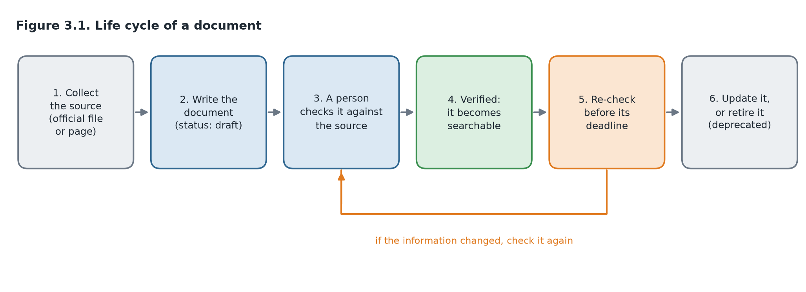
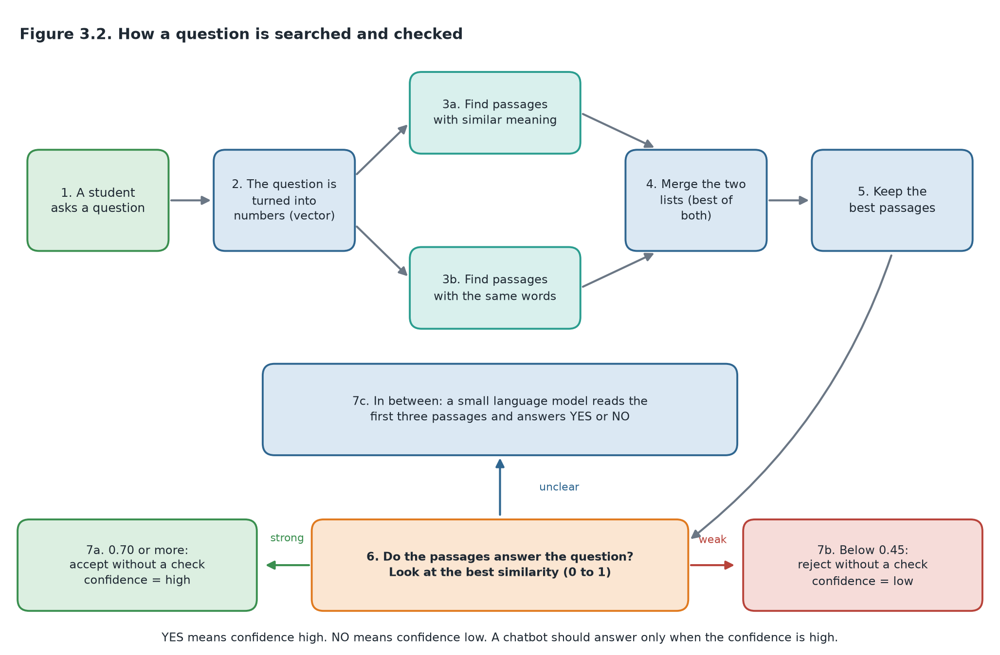
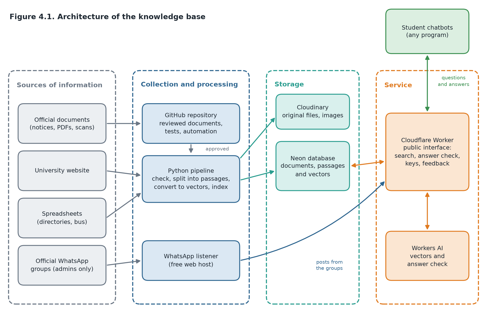

# Design and Implementation of a Shared Knowledge Base for ICT University Chatbots

Course: CSC 4121 Artificial Intelligence, Fall 2026
Institution: ICT University, Yaoundé, Cameroon
Project type: Group project, shared knowledge base
Authors (first version): EGBE MICHEL TAMBE, ICTU20233746; NDONWIE NELLY TANWIE, ICTU20233987; AJA CHELLA ASAMBA Jr, ICTU20233787
Full and current list of contributors: CONTRIBUTORS.md in the repository and https://github.com/Egbemichel/ictukb/graphs/contributors
Supervisor: Dr. Fotsing Kuetche
Date: 18 November 2026
Repository: https://github.com/Egbemichel/ictukb

---

## Abstract

Students and staff of ICT University often need answers to everyday questions: how much to pay, when to register, how to ask for a transcript, where a class is held. The answers are spread over a website, signed notices, policy documents and an administrative system. A chatbot can help, but only if it reads correct data.

This report describes a shared knowledge base that many student chatbots can read from. The system stores official documents, website pages and short daily announcements as small pieces of text called passages. It keeps them in a database that can search by meaning and by keywords. After a search, it checks whether the passages really answer the question. Any chatbot can use the system through a free public interface with an access key. Every document records where it came from, who checked it and how often it must be checked again. When two sources disagree, the most recent signed official document wins. Private information is never stored.

At the time of writing, the database holds 80 documents split into 679 passages. We tested it with 103 questions. For the 98 questions that the university's documents can answer, 63 (64.3%) already had a matching document in the database. For those 63 questions, the correct document was among the first five results 88.9% of the time, and for all 19 of the most important questions. All 5 questions that the system should not answer were refused. The system works and costs nothing to run. The main work left is to collect the missing documents from the university's offices.

Keywords: knowledge base, information retrieval, vector search, hybrid search, chatbot, university information, data quality.

---

## Table of contents

1. Introduction
2. Literature review
3. Methodology
4. System design
5. Implementation
6. Results and discussion
7. Conclusion and recommendations

References

Appendix A: Document metadata
Appendix B: Interface summary
Appendix C: Test question format
Appendix D: Repository layout

---

## Chapter 1. Introduction

### 1.1 Background

A university produces a lot of practical information. Applicants need to know how to apply and which papers to send. Students need to know the dates of registration, the amount of tuition and how to pay it in parts. They also need to know how to ask for a transcript, how to resit an exam, when their classes are held and where an office is. This information is kept in many places: pages of the website, signed notices, policy documents, forms, messages in official WhatsApp groups and the university's administrative system (the ERP). No single place gives the full answer to a question like "Until when can I register for courses, and what happens after that date?". The answer may be split between a communiqué and a notice from the finance office.

A chatbot is a natural way to ask such questions. But a chatbot that answers from its general knowledge will sometimes give a wrong answer about one particular university, and it will sound sure of itself. A better method has two steps. First, the chatbot looks up the relevant passages in a trusted store. Second, it writes its reply from those passages. This method is called retrieval-augmented generation (Lewis et al., 2020). It has one clear consequence: a reply can never be more correct than the store it reads from.

In the course CSC 4121 (Artificial Intelligence), each student builds a personal chatbot for the university. The class decided that all chatbots would read from one shared knowledge base. This avoids having each student collect the same data again. This report describes that knowledge base.

### 1.2 Problem statement

Three problems led to this project.

1. **Scattered information.** Official information lives in many places and formats. Some of it is in scanned images that cannot be searched.
2. **Information that changes.** Some facts change each semester (fees, dates, timetables). Others change every day (the canteen menu, announcements). A fixed set of documents becomes wrong if nobody updates it.
3. **Trust.** A student who gets a wrong deadline or a wrong amount from a chatbot can lose money. The system must know which facts are checked, where they come from and how recent they are. It must also know when it does not have the answer.

### 1.3 Objectives

The general objective was to design, build, deploy and test a shared and open knowledge base about ICT University. Student chatbots can use it to get correct, current information with its source.

The specific objectives were:

1. to decide what the knowledge base must contain and to collect it from official sources;
2. to design a data model that records the source, date, owner and check status of every document;
3. to build a pipeline that turns documents, web pages, spreadsheets and messages into searchable passages;
4. to build a search that works in English and French and that can tell when it has no answer;
5. to offer a public interface with access keys, and to host it for free;
6. to keep the data up to date, with daily and near real-time updates;
7. to measure the quality of the search with a fixed list of test questions.

### 1.4 Research questions

RQ1. Can a search that combines meaning and keywords return the right official document among the first five results for most questions?

RQ2. Can the system tell the difference between questions the documents can answer and questions they cannot?

RQ3. Can the system be built, hosted and kept up to date using only free services?

### 1.5 Scope and limits

The knowledge base covers thirteen categories: the university, admissions, programs, academic procedures, finance, the ERP, the campus, transport, the canteen, timetables, people, student life and announcements. It includes the Fall 2026 timetable of the undergraduate English program. Other timetables are not included. The system stores no personal data. It does not write replies; each chatbot does that. This report does not test any chatbot. It tests only the knowledge base.

### 1.6 Significance

The project gives the class one reliable source of facts about the university and removes repeated work. It also shows a complete method, from collection to hosting, that other departments can reuse. Because every fact has a source and a date, mistakes can be found and fixed.

### 1.7 Key terms

Passage (chunk): a short piece of a document, such as a few sentences or part of a table. It is stored and found as one unit.

Embedding (vector): a list of numbers (here 1,024 numbers) that stands for the meaning of a text. Texts with similar meaning get similar vectors.

Retrieval: finding the passages that best match a question.

Freshness tier: the longest time allowed between two checks of a document.

Verified document: a document that a named person has compared with an official source.

### 1.8 Organisation of the report

Chapter 2 reviews earlier work. Chapter 3 explains the method. Chapter 4 describes the design of the system and Chapter 5 how it was built. Chapter 6 gives and discusses the results. Chapter 7 concludes and gives recommendations.

---

## Chapter 2. Literature review

### 2.1 Answering questions from a fixed set of documents

Answering questions from a small set of trusted documents is different from answering any question about anything. The set is small, we know who wrote it, and a mistake costs something. For this reason, university assistants usually look up the university's own documents instead of relying on general knowledge. Three design questions follow: how to represent the documents, how to search them, and how to keep them correct over time.

### 2.2 Keyword search and meaning search

Classic search ranks documents by the words they share with the question. A well-known method is BM25. It gives more weight to rare words and takes the length of the document into account. It has been a strong baseline for many years (Robertson and Zaragoza, 2009; Manning, Raghavan and Schütze, 2008). Its weak point is that different words can mean the same thing. A question that says "pay in instalments" will not match a passage that says "tuition may be settled in parts".

Meaning search (dense retrieval) fixes this. A trained model turns the question and each passage into vectors, and the search ranks passages by how close their vectors are (Karpukhin et al., 2020; Reimers and Gurevych, 2019). Some models handle many languages in the same space, so a French question can find an English passage. This is useful at a bilingual university.

Meaning search also has a weak point. It can return a passage on the right topic that does not contain the fact asked for. It is also weaker with exact names and codes, such as course codes. Using both kinds of search together is a common solution.

### 2.3 Fast vector search and combining two result lists

Comparing a question with every stored vector is slow when there is a lot of data. Vector databases therefore use approximate nearest-neighbour indexes. One of the best is the HNSW graph (Malkov and Yashunin, 2020). It is available in pgvector, an extension for the PostgreSQL database (Kane, 2021). When vectors and other data are in the same database, one query can search and filter by category, level or date.

Two ranked lists, one from keywords and one from meaning, can be merged with reciprocal rank fusion. Each passage gets a score equal to the sum of 1 divided by its rank in each list (Cormack, Clarke and Büttcher, 2009). This method does not need any tuning of score scales, and it worked better than several more complex methods.

### 2.4 Retrieval-augmented generation and where it fails

In retrieval-augmented generation, the retrieved passages are given to a language model together with the question (Lewis et al., 2020). Two failures matter here. First, if the passages do not contain the answer, the model may still reply with confidence. Second, if the passages are old or contradict each other, the reply repeats the error. Both problems come from the store and the search, not from the writing of the reply. This is why the project puts its effort into checking passages and recording where documents come from.

### 2.5 Splitting documents into passages

Documents are cut into passages before they are indexed. A passage that is too long mixes several ideas and the vector becomes less precise. A passage that is too short loses its context. It works well to cut along the structure of the document (headings, paragraphs, table rows) and to put the title and heading at the start of each passage, so it can be understood alone. Tables need special care: they are cut by rows, and the header row is repeated in every piece.

### 2.6 Freshness and source

The quality of information depends on how recent it is and on who wrote it. Fees and timetables are valid for one semester. An announcement is valid for a few days. If each document has an expected lifetime and a date of last check, and both are shown to the user, the system can warn when information may be old. If the source and the person who checked it are recorded, an error can be traced and fixed. A clear rule for conflicts also makes the result predictable. Here, the rule is that the most recent signed official document wins.

### 2.7 Measuring search quality

Search is usually tested with a fixed list of questions for which the right documents are known. The measure "hit at k" says whether a right document is among the first k results. The mean reciprocal rank (MRR) is the average of 1 divided by the position of the first right result (Voorhees, 1999). A system that must also refuse some questions needs one more measure: the share of unanswerable questions it refused. The list of questions can be written before the documents exist. For this reason, the share of questions with a document in the database must be reported separately. Otherwise, a missing document looks like a search error.

### 2.8 The knowledge base as part of an agent

In this course, a chatbot is an agent. It receives the student's messages and its actions are its replies. An agent that must give correct answers needs a knowledge component that is accurate, current and easy to query (Russell and Norvig, 2021). The knowledge base in this report is that component. It is kept outside the agent so that it can be shared and updated on its own.

### 2.9 What this project adds

The search methods already exist. This project puts them together for one institution under real limits: a small, bilingual and partly scanned set of documents, facts that change at different speeds, no budget, and a result that must be open to a whole class. The next chapters show how these limits shaped the method.

---

## Chapter 3. Methodology

### 3.1 Research design

We worked in repeated cycles. Each cycle had four steps: collect a batch of sources, turn them into documents and index them, measure the search quality with the fixed list of questions, and fix the data or the system where the questions failed. We wrote the list of questions before the documents existed. This way, progress could be measured fairly. Chapter 6 gives the results of each cycle.

### 3.2 Requirements

The requirements came from the course brief and from the questions students ask. The people concerned are the students who build chatbots, the students and staff who ask questions, and the administration.

Functional requirements. The system must:

- store the thirteen categories of information, including documents, images and tables;
- answer questions in English and French;
- return the source and the date of the last check with every result;
- recognise questions that it cannot answer;
- accept fast updates for information that changes quickly;
- give every chatbot access through a documented interface with access keys.

Other requirements. The system must:

- be open source and protected against unauthorised changes;
- hold no sensitive data;
- cost nothing to run;
- be easy to maintain by a team of students that changes over time.

### 3.3 Sources and how we collected them

We collected information from the sources below, from the most official to the least.

| Source | Content | Method |
|---|---|---|
| Signed notices, policies and letters | Academic regulations, registration dates, fee control, bank accounts | Files supplied by the team; scanned pages read and typed in |
| ERP user manual | Procedures, grading scale, fees, resits, transcripts, complaints | Read from the official manual inside the system; no personal data used |
| University website | Programs, admission requirements, faculties, calendar, news | Public interface of the site, read every day |
| Timetable (PDF) | Lectures of the Fall 2026 semester | Table extraction, then per-day tables and per-program lists |
| Messages of official groups | Canteen menu, announcements, student-life news | Messages from the administrators of four official groups, received automatically |
| Spreadsheets | Directories, canteen, transport | Templates prepared; the offices must fill them |

Seven rules guided the collection:

1. every item records its source, date and collector;
2. original files are kept and not retyped;
3. files are named by category, topic and date;
4. anything said verbally is confirmed in writing;
5. if two sources disagree, the most recent signed official document is used, and the disagreement is written in the document;
6. only official contact details are stored;
7. no secret or personal data enters the repository.

One unofficial report that someone had compiled was given to us during the project. It did not come from the university, so we did not use it to verify facts.

To organise the work, we first defined a catalogue of 85 documents. For each document, the catalogue lists the questions it must answer, the files to obtain, the office in charge and a priority. P0 is the core service, P1 is completeness and P2 is extra coverage. From this catalogue, the project generated an empty draft for each document, spreadsheet templates and a checklist of about 80 files to obtain.

### 3.4 Checking and governance

Each document has a status: draft, verified or deprecated (no longer valid). Only verified documents can be seen in production. A document can become verified only if it has no unfinished placeholder, names the person who checked it and has an owner. A validation program enforces these rules. It also rejects email addresses outside the official domains and badly formed metadata.

Figure 3.1 shows the life of a document, from its source to its retirement.

The freshness tier sets how old the last check may be: one day for real-time information, seven days for daily information, 120 days for semester information and 365 days for fixed information. A document that is older than its limit is reported as stale, and an issue is opened for its owner.

The project also keeps a list of contributors in a file called `contributors.yml`. Each person who adds work adds one entry with their name, matricule and GitHub login in the same pull request. A script builds the file `CONTRIBUTORS.md` from it, and the automatic checks reject a pull request whose author is not listed. In this way, the list of authors follows the real work in the repository, and readers can refer to it instead of a fixed list in this report.

### 3.5 Privacy and ethics

The knowledge base is meant to be open. For this reason, we took the following measures.

- No personal data is stored. Questions about one person's grades or balance are deliberately left unanswered.
- The university's bank account numbers are known to students, but we did not put them in the public repository. They are in a private folder that Git ignores, and they are indexed only from the maintainer's computer.
- The website is read through its public interface, and we respect its crawl delay of 20 seconds.
- The WhatsApp messages are read with the number of a member of the groups. Only messages from group administrators are used. Phone numbers, mentions and unofficial email addresses are removed before anything is stored. The group administrators should be told that this number is a member.
- Access to the interface needs a key, and a key can be cancelled.

### 3.6 Data model

Each curated document is a Markdown file with structured metadata (Appendix A). The metadata gives an identifier, title, category, level, language, source type and address, attachments, validity dates, freshness tier, status, date of last check, the person who checked it, an owner, the collector and a note about conflicts. The body is organised under headings written as the questions a student would ask. Binary files (PDFs and images) are kept in a media service and never in the repository. The text extracted from them is reviewed in the repository and indexed together with a description written by a person.

### 3.7 Processing pipeline

For each document, the pipeline does four things:

1. it checks the metadata against a schema;
2. it cuts the body into passages along headings and paragraphs, and it puts the document title and heading at the start of each passage;
3. it turns each passage into an embedding;
4. it writes the document and its passages to the database.

A hash of the content lets the pipeline skip documents that did not change. Documents that no longer exist at their source are removed. The name of the embedding model is stored in the database, so vectors from two different models are never mixed.

### 3.8 Search and answer check

A search has three stages. First, the question is turned into an embedding. Second, two lists of 40 passages are made: one with the passages closest in meaning (cosine similarity), and one with the passages that contain the important words of the question (full-text search). Third, the two lists are merged by reciprocal rank fusion with the constant 60, and the best passages are returned with the data of their documents. Filters by category, level and language apply to both lists. Documents past their validity date are never returned.

Then the system decides whether the passages answer the question. Figure 3.2 shows the steps.

If the best similarity is 0.70 or more, the answer is accepted without a check. If it is below 0.45, it is rejected. Between these two values, a small language model reads the first three passages and answers yes or no to the question "Do these passages contain the answer?". The interface returns the result as a confidence level (high, low or none). We chose the two limits after looking at the similarities of answerable and unanswerable test questions (section 6.3).

### 3.9 How we evaluated the system

We wrote 103 test questions before collecting the content. There are 98 answerable questions. Of these, 6 are French or misspelled versions of other questions and 4 need two documents. The other 5 questions must not be answered, for example a private phone number, a personal balance or a prediction. For every answerable question, we listed the documents that answer it. We used five measures:

- coverage: the share of answerable questions for which the expected document is in the database;
- hit at 5: among covered questions, the share for which an expected document appears among the first five results (all of them, for two-document questions);
- mean reciprocal rank (MRR);
- the share of found answers that get high confidence;
- no-answer correctness: the share of unanswerable questions marked low or none.

Hit at 5 and MRR are computed only on covered questions. In this way, a missing document is not counted as a search error. The targets were 85% for hit at 5 overall and 95% for the most important (P0) questions.

### 3.10 Tools

The pipeline is written in Python. The database is PostgreSQL with the pgvector extension, hosted by Neon. Cloudflare Workers AI provides the embeddings and the model that checks answers. Cloudinary stores files. The public interface runs on Cloudflare Workers. GitHub Actions runs the automatic jobs. The WhatsApp reader is a Node.js program on a free web host. We used every service within its free limits.

---

## Chapter 4. System design

### 4.1 Architecture

Figure 4.1 shows the whole system. Information comes from the sources on the left. The pipeline and the WhatsApp reader process it and store it in the database and the file store. The public interface then serves it to the chatbots.

The design separates three concerns: curation (the files in a Git repository and the sources that feed them), storage and search (the database and the public interface), and use (the chatbots).

### 4.2 Storage

The database has two main tables. A document row holds the metadata of Appendix A and an origin: curated file, website, spreadsheet, short-lived post or private file. The origin lets each import path delete only the documents that it created. A passage row holds the text, the heading path, the source (body, attachment or sheet), the embedding and a full-text vector made from the text. Other tables hold the access keys (stored as hashes), feedback reports, import runs, the embedding model name and the state of the WhatsApp reader.

### 4.3 Indexes

The embeddings are indexed with an HNSW graph using cosine distance. The full-text vectors use an inverted index with a language-neutral setting, because the documents are in two languages. A combined index on category, status and freshness tier makes filtering fast.

### 4.4 Public interface

The interface is a small set of HTTP endpoints (Appendix B). The main endpoint takes a question, an optional number of results and optional filters. It returns the passages with the confidence level and the way it was checked. For each passage it also returns the document identifier, title, category, source address, attachments, date of last check, freshness tier and a stale flag. Other endpoints list the categories, report freshness, return a whole document, accept feedback and report health. A separate group of administrator endpoints, protected by its own token, creates and cancels access keys, publishes and deletes short-lived posts and stores the state of the WhatsApp reader. No endpoint edits curated content. Curated documents change only through the repository and the pipeline.

Access keys are random, shown once and stored only as hashes. Each key has a limit of requests per minute. Requests from other websites are allowed, but the documentation advises developers to keep the key on a server.

### 4.5 Ways to add data

Four connectors fill the same tables:

1. curated files, checked and then indexed after review;
2. the website, read every day through its public content interface, with a change record for each page;
3. spreadsheets, shared as read-only, turned into text rows that can be understood alone, and grouped into one document per group (for example per program and semester);
4. short-lived posts, made from messages, which have a validity period and are deleted automatically when it ends.

An intake command registers collected files. It uploads the original, extracts its text and attaches it to the matching document. It creates a draft if there is none.

### 4.6 Live information

Administrators publish the canteen menu, the bus information and the announcements in messaging groups. A reader linked to a member number receives those messages. It keeps only the messages written by group administrators and removes personal data. It reads the text of menu photos with a vision model and publishes each message as a post. Several menu messages from the same day are merged into one menu. If a message is edited or deleted, the post is updated. The reader keeps its session in the database, so it can run on a host without a disk and restart without linking again.

### 4.7 Hosting

The public interface runs as a Cloudflare Worker. This is free, always on, and it reads the database over HTTP. The WhatsApp reader runs as a free web service. A scheduled task of the Worker contacts it every five minutes so that it does not go to sleep. The pipeline runs from a maintainer's computer and from scheduled GitHub Actions jobs: a live job every 15 minutes, a daily job for the website and the sheets, and a deploy job at every change of the main branch. A repository variable switches these jobs on once the required secrets are set.

### 4.8 Security

The repository is public, so secrets never enter it, and a scanner checks every change. Administrator actions need a token that only the maintainers hold. Review rules and required checks protect the main branch. The WhatsApp session of the reader is a credential. It is stored in the database and not in the repository.

### 4.9 Design decisions and trade-offs

Git as the source of truth. Curated content lives in Markdown files, so every change is reviewed, attributed and reversible. The cost is that every change needs a pull request. This is acceptable for facts that change slowly.

Separate paths for fast-changing data. Committing a menu to Git every day would not be practical. This data goes straight to the database and expires on its own.

A JavaScript interface next to the Python code. The free Cloudflare platform cannot run the Python database driver, so we wrote the public interface for the Worker runtime. The Python pipeline stays the reference for indexing and testing, and both use the same database.

A private folder for sensitive but useful data. Some facts are valuable for chatbots but should not be in a public repository. A separate folder that Git ignores is indexed from one computer under its own origin, so the public automation never deletes it.

A threshold plus a model for checking answers. A similarity threshold alone could not separate answerable from unanswerable questions (section 6.3), so a small model checks the unclear cases. Very strong and very weak matches skip the model, which saves cost and time.

---

## Chapter 5. Implementation

### 5.1 Repository and modules

The repository (Appendix D) holds the curated content, the schema and catalogue, the Python package, the Worker, the WhatsApp reader, the test questions, the workflow files and the documentation. The Python package has about 3,000 lines. Its modules cover configuration, database access, content validation, chunking, embedding, indexing, search, evaluation, the website and spreadsheet connectors, file intake, document parsers, freshness reports, access keys and a command-line tool. The Worker has about 500 lines and the WhatsApp reader about 600. The automatic tests have about 480 lines of Python and 15 tests in JavaScript.

### 5.2 Content validation

The metadata is validated with a JSON Schema. More rules check that:

- the file name equals the identifier and the folder matches the category;
- referenced documents exist and dates are consistent;
- email addresses belong to the official domains;
- verified documents have no placeholder and name their verifier;
- attachment text files exist.

Phone numbers give a warning for the reviewers. The validation runs at every change.

### 5.3 Chunking

Markdown is cut at headings, and each section is cut into paragraphs of up to about 380 tokens. Each passage starts with the document title and the heading path. Tables are cut by rows and the header is repeated in each piece. In the database, passages are about 110 tokens long on average, because most documents are made of short question-and-answer sections.

### 5.4 Embeddings

The first version used a hosted multilingual embedding service with 1,024 dimensions. After we had repeated the evaluation several times, the free key reached its monthly limit of 1,000 calls, and the public interface stopped answering new questions. We replaced the model with a free multilingual model of the same size from the hosting platform. The Worker now computes the embeddings for questions and documents, and the Python pipeline asks the Worker for document embeddings. In this way, every vector in the database comes from one model. We re-embedded the 679 passages with one command and recalculated the thresholds (section 6.3). The stored model name prevents mixing by mistake.

### 5.5 Indexing and search

The indexer computes a hash of the title and passages. It skips documents that did not change and only refreshes their metadata. For changed documents, it replaces the passages. After each run, it deletes the documents of the same origin that no longer exist at the source. A safety rule refuses to delete everything when a source returns nothing. The search is one SQL statement that builds the two lists, merges them and returns the best passages with their document data. It uses positional parameters, so the Python and JavaScript versions share the same query.

### 5.6 Connectors and files

The website connector reads pages and recent news through the site's structured content interface. It converts HTML to Markdown, removes repeated blocks and puts each page in a category using rules on its address. The spreadsheet connector turns rows into text lines that can be understood alone and groups them. The intake command extracts text from PDF, Word, Excel, CSV and image files. Three problems needed special handling:

- scanned documents have no text layer, so we read the pages as images and typed their content into the document, keeping the scan as an attachment;
- one PDF stored its text with one word per line, which we repaired by joining the lines;
- the timetable PDF was extracted by table position and not as plain text. This recovered 85 sessions with course, lecturer, hall, time and audience. From these we built per-day tables, a list of lecturers per course and the courses of each program and year.

### 5.7 The Worker

The Worker implements the endpoints of Appendix B. It hashes keys with SHA-256, keeps key lookups in memory for one minute and limits the request rate of each key. It calls the database over HTTP, computes embeddings and runs the answer check. Identical questions are cached for five minutes. The administrator endpoints publish and delete posts, create and cancel keys, compute embeddings for the pipeline and store the state of the WhatsApp reader. Error messages never include connection strings.

### 5.8 The WhatsApp reader

The reader uses an unofficial library for the linked-device protocol. It decides the post type from the name of the group and uses only messages written by administrators. It removes personal data, reads photos with a vision model, merges daily menus, handles edits and deletions, and keeps its session and records in the database. It has a health address, stops when another copy takes over the session and saves its state when it shuts down. Using an unofficial client brings a risk: WhatsApp may block the number, or a protocol change may stop the service. We accept this risk and have documented it.

### 5.9 Automation and testing

The workflows do the following:

- validate every change (style checks, schema validation, a scan for secrets and the tests, including database tests on a temporary pgvector instance);
- evaluate the search;
- import data on a schedule;
- report stale documents;
- deploy the system.

There are 38 automatic tests: 23 for the Python code (8 of them need a database), 4 for the Worker and 11 for the WhatsApp reader. They cover validation rules, chunking, the keyword query, the connectors, intake, indexing, deletion of old documents, search filters, key checks and rate limits, posts and their expiry, removal of personal data, routing, menu merging, edits, deletions and the session store. A check on the contributors list runs as well.

### 5.10 Problems and how we solved them

| Problem | Cause | Solution |
|---|---|---|
| Scanned documents could not be searched | No text layer | Pages read as images and typed in; scan attached |
| Timetable text was garbled | Table layout lost in plain extraction | Extraction by table position and rebuilt as tables |
| Conflicting values (attendance 75% and 80%, three registration dates) | Different documents and dates | Most recent signed official document used; conflict recorded |
| Unanswerable questions returned passages that looked relevant | Similarity of unrelated topics overlaps with that of real answers | Answer check step |
| Public interface stopped answering | Monthly call limit of the embedding service reached | Free embedding model on the platform; re-embedding |
| Secrets rejected in production | Quotes and carriage returns copied from a local file | Cleaning when setting secrets; documented |
| Private data in a public repository | Bank accounts in a document | Private folder with its own origin; fixed a defect that marked it as public content |
| Free server could not run the interface | Native database driver not supported | Interface rewritten for the Worker runtime |
| WhatsApp reader lost its session on restart | No disk on the free host | Session stored in the database |
| Idle database connections closed during long evaluations | Pooler timeout | Short connections and retries |

---

## Chapter 6. Results and discussion

### 6.1 The documents

On 18 November 2026 the database held 80 documents and 679 passages. The 80 documents were 46 curated and verified documents, one private document and 33 pages of the university website. By category: programs 34, ERP 10, admissions 9, procedures 8, about 6, finance 6, timetables 2, announcements 2, people 2 and campus 1. Seventy-nine documents are in English and one is in French. Six documents have attachments.

Of the 85 documents in the catalogue, 46 (54%) were complete: 21 of 22 at priority P0, 23 of 48 at P1 and 2 of 15 at P2. The only P0 document still missing is the office directory, which the administration postponed. The canteen menu, bus and student-life information come from live posts and not from documents. These categories were empty at the time of the evaluation, because no administrator message had arrived yet.

The finance documents use the figures confirmed by the project team as official: complete tuition of XAF 365,000, a student union fee of XAF 2,000, and payment in three installments of 50%, 30% and 20% of the tuition. The Bursar's notices confirm the first installment and the dates of the second. The date of the third installment has not been published.

### 6.2 Search quality over the cycles

Table 6.1 shows the evaluation after each large batch of data. The test questions did not change.

Table 6.1. Search quality by cycle

| Stage | Covered questions | Hit at 5 (covered) | P0 hit at 5 |
|---|---|---|---|
| Website pages only | 5 of 98 (5.1%) | 60.0% | not covered |
| Plus official notices and the ERP manual | 38 of 98 (38.8%) | 94.7% | 100.0% (11 of 19 covered) |
| Plus timetable, regulations policy and further notices | 46 of 98 (46.9%) | 91.3% | 92.9% (14 of 19) |
| Plus admissions, programs, contacts and fee documents | 63 of 98 (64.3%) | 92.1% | 94.7% (19 of 19) |
| After change of embedding model and answer check | 63 of 98 (64.3%) | 88.9% | 100.0% (19 of 19) |

Coverage rose from 5% to 64% as we added official documents. On covered questions, the accuracy stayed between 89% and 95%, which is above the target of 85%. The final system reached the P0 target of 95% (19 of 19). The previous embedding model missed this target by one question.

### 6.3 Answering and refusing

Table 6.2 gives the final results, measured on the live interface.

Table 6.2. Final results on the live interface

| Measure | Value | Target |
|---|---|---|
| Questions in the test set | 103 | |
| Answerable questions with a document in the database (coverage) | 63 of 98 (64.3%) | |
| Hit at 5 on covered questions | 88.9% | 85% |
| Hit at 5 on covered P0 questions | 100.0% (19 of 19) | 95% |
| Mean reciprocal rank | 86.6% | |
| Found and answered with high confidence | 82.1% | |
| No-answer correctness | 100.0% (5 of 5) | |

Before the answer check existed, confidence was decided by a similarity threshold, and no unanswerable question was refused (0 of 5). The similarities of the unanswerable questions were between 0.47 and 0.63. The similarities of correctly found answerable questions were between 0.50 and 0.75, with a median of 0.69. Because the ranges overlap, no single threshold could separate them. A test based on shared words between the question and the passages also failed, because answerable questions often use different words from the passage.

We then compared rerankers and language-model judges on the same questions. One reranker refused four of the five unanswerable questions but lost the French questions. A second reranker refused all five, but its trial key allows only about ten calls per minute, which is too low for a public interface. A small language model refused all five unanswerable questions and accepted 74% of the answerable ones. We chose it for the unclear middle range: accept without a check above 0.70 and reject without a check below 0.45. All five unanswerable questions are now marked low confidence. This includes the question about a private phone number, whose closest passage is the official contact page.

Some of the 18% of answerable questions without high confidence are correct behaviour. For the questions about application deadlines and the per-program fee schedule, the database says that the information is not yet available and sends the student to the Admissions office. A refusal is the right result there.

### 6.4 Failures

Seven questions failed.

- Three need two documents and returned only one (a transcript and clearance question, a resit and fee question, and a Masters requirements and fee question). The second document of each pair is in the database. A chatbot can fix this by searching twice.
- One question about the credits of a course returned program pages with high confidence, although no document gives course credits. This is the only wrongly accepted answer we saw. It shows the limit of an answer check that reads only the first three passages.
- Two questions are vague (the office hours of a staff member, and whether a class was moved this week). They got low confidence, which is correct.
- One question asked for the lecturers of a department. It returned the course lists of the program, but the list of lecturers was not among the first five results.

None of the failures concerns a high-priority topic.

### 6.5 Speed and cost

From the maintainers' network, a search normally answered in 0.7 to 1.5 seconds. One search with a model check took 9 seconds. Repeated identical questions are answered from a cache in under one second. The whole system runs within the free limits of its providers. We estimate that the daily limit of the model service allows about a thousand model checks per day. The checks are skipped for very strong and very weak matches. When the limit is reached, the interface falls back to a similarity threshold of 0.64. This threshold refused all five unanswerable test questions and kept about 80% of the correct answers at high confidence.

### 6.6 How the system runs

The interface, database, scheduled jobs and WhatsApp reader are deployed. The deploy job succeeded at each change after the secrets were set, including a re-indexing step. The live job and the daily job (including a crawl of the website from the automation runner) also succeeded. The reader reconnected from its stored session on a host with no local files, found the four configured groups and reported that it was connected. On 18 November 2026 at 11:57 local time, the reader received a real announcement from an official group (an information notice about the new schedule of the e-Agriculture entrance examination) together with its image. The text of the image was read and stored with an expiry date, and a search through the interface found it with high confidence. This is the first proof that the whole path works with a real message: group, image reading, database and interface.

### 6.7 Discussion

RQ1. The hybrid search returned the right document among the first five results for 88.9% of covered questions, and for all the high-priority ones. Both are above the targets. This holds for a set of 80 documents. A larger set may need new tuning.

RQ2. Similarity alone could not separate answerable from unanswerable questions. The added answer check, which uses a model only for unclear cases, did it for the whole test set. We have only five unanswerable test questions. The figure of 100% shows that the approach works, but it is not a precise rate.

RQ3. All components run within free limits. The price of this is that we depend on quotas and on hosts that may sleep or restart. The embedding limit showed this when it stopped the interface. The design reduces both risks: the model can be replaced, the state is in the database, and the interface falls back to simpler behaviour when a service is down.

The project also showed that the quality of the data matters more than the quality of the technology. The main limit is coverage, not search accuracy: 35% of answerable test questions cannot be answered because we do not yet have the document. The source order and the conflict notes also proved necessary. Three official documents gave three different registration dates, and two gave different attendance rules.

### 6.8 Limitations

1. The project team wrote the test set, so it may not match the questions students really ask. Five unanswerable questions are too few for a precise estimate.
2. The team chose the expected documents for each test question, and some questions have more than one acceptable document. The evaluation accepts any document in the list.
3. Coverage is incomplete. The office directory, deadlines, the fee schedule per program, PhD programs and bus information are missing.
4. The answer check uses a small language model. Its behaviour may change if the provider updates it.
5. The WhatsApp reader depends on an unofficial client, and a free host does not guarantee that it stays on.
6. We measured speed from one place and with few samples.

---

## Chapter 7. Conclusion and recommendations

### 7.1 Summary

The project delivered a working, documented and deployed knowledge base for ICT University. It turns official documents, website pages, spreadsheets and administrators' messages into searchable passages. It searches them by meaning and by keywords, decides whether they answer the question, and serves them through a public interface with access keys, at no cost. Every document records its source, who checked it and how fresh it is. On 103 test questions, it found the right document among the first five results for 88.9% of the questions that the data covers, including all the most important ones, and it refused every question that it should not answer.

### 7.2 Contributions

1. A method, driven by a catalogue, to define, collect and track the information of a university, with an automatic collection checklist.
2. A document model that records the source, the checker, the validity and the freshness of every fact, with a clear rule for conflicts.
3. A search interface that mixes meaning and keyword search and tells whether the result answers the question.
4. Hosting on free services, with automation for validation, scheduled imports, evaluation and release.
5. A reusable set of test questions and an evaluation method that separates missing data from search errors.
6. A list of contributors that is built from the repository, and documentation for contributors and chatbot developers (a user manual).

### 7.3 Limitations

The limitations in section 6.8 apply. In addition, the knowledge base answers questions of fact only. It does not hold the personal data that many students would like a chatbot to use, and it does not support transactions.

### 7.4 Recommendations

For the project team:

1. Get the missing P0 and P1 documents in this order: the fee schedule per program from the finance office; the application deadlines and the application guide from the admissions office; the lists of offices, rooms and staff from the administration; the curriculum, course descriptions, graduation rules and thesis rules from the registrar and the heads of department.
2. Collect the first real messages of the official groups and check that menus and announcements appear correctly.
3. Replace the exam timetable placeholder with the official notice when it is published.

For the administration:

4. Name an owner for each category and publish notices as files, so they can be indexed.
5. Publish one current academic calendar and one current fee schedule, and withdraw the old versions, to avoid conflicting dates.
6. Tell the administrators of the official groups that a member number reads their messages.

For chatbot developers:

7. Answer only when the interface reports high confidence, show the source and the date of the last check, and warn when a document is stale.
8. Keep the access key on a server, and send feedback for wrong or missing answers.

For the maintainers:

9. Change the database password that was shown during development, review the access keys from time to time, and keep the daily and live jobs on.
10. Run the evaluation again after every batch of new documents, and add the questions that students really ask.

### 7.5 Future work

- Add a second search round for questions that need two documents.
- Add more test questions, especially unanswerable ones, and check how stable the answer check is over time.
- Fill the spreadsheets for directories, bus routes and clubs, and synchronise them automatically.
- Add a simple text-based guide to the inside of the building, which the team is preparing.
- Add the timetables of the other sections and of the Masters programs.
- Test complete chatbots built on the interface, with students as users.
- Improve the search for French questions about English documents. During testing, a French question about transcripts returned a document about complaints.

---

## References

Cormack, G. V., Clarke, C. L. A. and Büttcher, S. (2009) 'Reciprocal rank fusion outperforms Condorcet and individual rank learning methods', Proceedings of the 32nd International ACM SIGIR Conference on Research and Development in Information Retrieval, pp. 758-759.

Kane, A. (2021) pgvector: open-source vector similarity search for Postgres. Available at: https://github.com/pgvector/pgvector (Accessed: 18 November 2026).

Karpukhin, V., Oguz, B., Min, S., Lewis, P., Wu, L., Edunov, S., Chen, D. and Yih, W. (2020) 'Dense passage retrieval for open-domain question answering', Proceedings of the 2020 Conference on Empirical Methods in Natural Language Processing, pp. 6769-6781.

Lewis, P., Perez, E., Piktus, A., Petroni, F., Karpukhin, V., Goyal, N., Küttler, H., Lewis, M., Yih, W., Rocktäschel, T., Riedel, S. and Kiela, D. (2020) 'Retrieval-augmented generation for knowledge-intensive NLP tasks', Advances in Neural Information Processing Systems, 33, pp. 9459-9474.

Malkov, Y. A. and Yashunin, D. A. (2020) 'Efficient and robust approximate nearest neighbor search using hierarchical navigable small world graphs', IEEE Transactions on Pattern Analysis and Machine Intelligence, 42(4), pp. 824-836.

Manning, C. D., Raghavan, P. and Schütze, H. (2008) Introduction to Information Retrieval. Cambridge: Cambridge University Press.

Reimers, N. and Gurevych, I. (2019) 'Sentence-BERT: sentence embeddings using Siamese BERT-networks', Proceedings of the 2019 Conference on Empirical Methods in Natural Language Processing, pp. 3982-3992.

Robertson, S. and Zaragoza, H. (2009) 'The probabilistic relevance framework: BM25 and beyond', Foundations and Trends in Information Retrieval, 3(4), pp. 333-389.

Russell, S. and Norvig, P. (2021) Artificial Intelligence: A Modern Approach. 4th edn. Harlow: Pearson.

Voorhees, E. M. (1999) 'The TREC-8 question answering track report', Proceedings of the Eighth Text REtrieval Conference (TREC-8), pp. 77-82.

---

## Appendix A. Document metadata

| Field | Type | Meaning |
|---|---|---|
| id | text | Stable identifier, equal to the file name |
| title | text | Title that a person can read |
| category | one of 13 | about, admissions, programs, procedures, finance, erp, campus, transport, canteen, timetables, people, student-life, announcements |
| program_level | list | all, bachelor, masters, phd |
| language | en or fr | Language of the document |
| source_type | list of values | official_doc, website, interview, sheet, image, observation |
| source_url | address or empty | Where the information comes from |
| attachments | list | Stored file identifier, kind, description, extracted text file |
| academic_year, semester | text | Period concerned |
| valid_from, valid_until | dates | Validity; documents past valid_until are not returned |
| freshness_tier | list of values | realtime, daily, semester, static |
| status | list of values | draft, verified, deprecated |
| last_verified, verified_by | date, handle | When and by whom the content was checked |
| owner, collected_by, collected_on | text, date | Responsibility and collection record |
| confirmed_in_writing | true or false | Whether verbal information was confirmed in writing |
| conflict_note | text | Description of a disagreement between sources |
| tags, related | lists | Keywords and related documents |

## Appendix B. Interface summary

| Method and path | Purpose | Access |
|---|---|---|
| GET /v1/health | Service status | none |
| POST /v1/search | Find passages for a question | key |
| GET /v1/documents/{id} | A document with all its passages | key |
| GET /v1/documents | List of documents | key |
| GET /v1/categories | Categories with document counts | key |
| GET /v1/freshness | Stale documents by category | key |
| POST /v1/feedback | Report a wrong, missing or outdated answer | key |
| POST /v1/admin/keys, DELETE /v1/admin/keys/{id} | Create and cancel access keys | admin token |
| POST /v1/admin/notes, DELETE /v1/admin/notes/{id} | Publish and delete short-lived posts | admin token |
| POST /v1/admin/transcribe | Read the text in an image | admin token |
| POST /v1/admin/embed | Compute embeddings for the pipeline | admin token |
| POST /v1/admin/wa-state/get, /set | Store the state of the WhatsApp reader | admin token |

The full description for chatbot developers is in the user manual (docs/user-manual.md).

## Appendix C. Test question format

Each question has an identifier, the text, a category, a type (factual, procedural, list, multi-hop, variant or no-answer), a language, a priority (P0, P1 or P2), the list of documents that answer it, and a field where the category owner writes the correct answer. A result matches an expected document when its identifier is equal to it, or starts with it followed by a hyphen. This lets grouped documents match, for example one timetable document per program.

## Appendix D. Repository layout

| Folder or file | Content |
|---|---|
| content/ | Curated documents (Markdown with metadata) and extracted attachment texts |
| content-private/ | Documents indexed from one computer only; not published |
| schema/ | Metadata schema, categories, catalogue of planned documents |
| sources/ | Settings of the website and spreadsheet connectors |
| src/ictkb/ | Python package: pipeline, command-line tool, reference interface |
| cloudflare-worker/ | Public interface for the Worker runtime |
| whatsapp-listener/ | WhatsApp reader |
| eval/ | Test questions and evaluation program |
| db/migrations/ | Database migrations |
| docker/, render.yaml | Container files and host blueprint |
| docs/ | Architecture, interface reference, collection guide, runbook, deployment, user manual, this report, figures |
| contributors.yml, CONTRIBUTORS.md | Source and generated list of contributors |
| .github/ | Workflows, issue and review templates |
| tests/ | Automatic tests |
